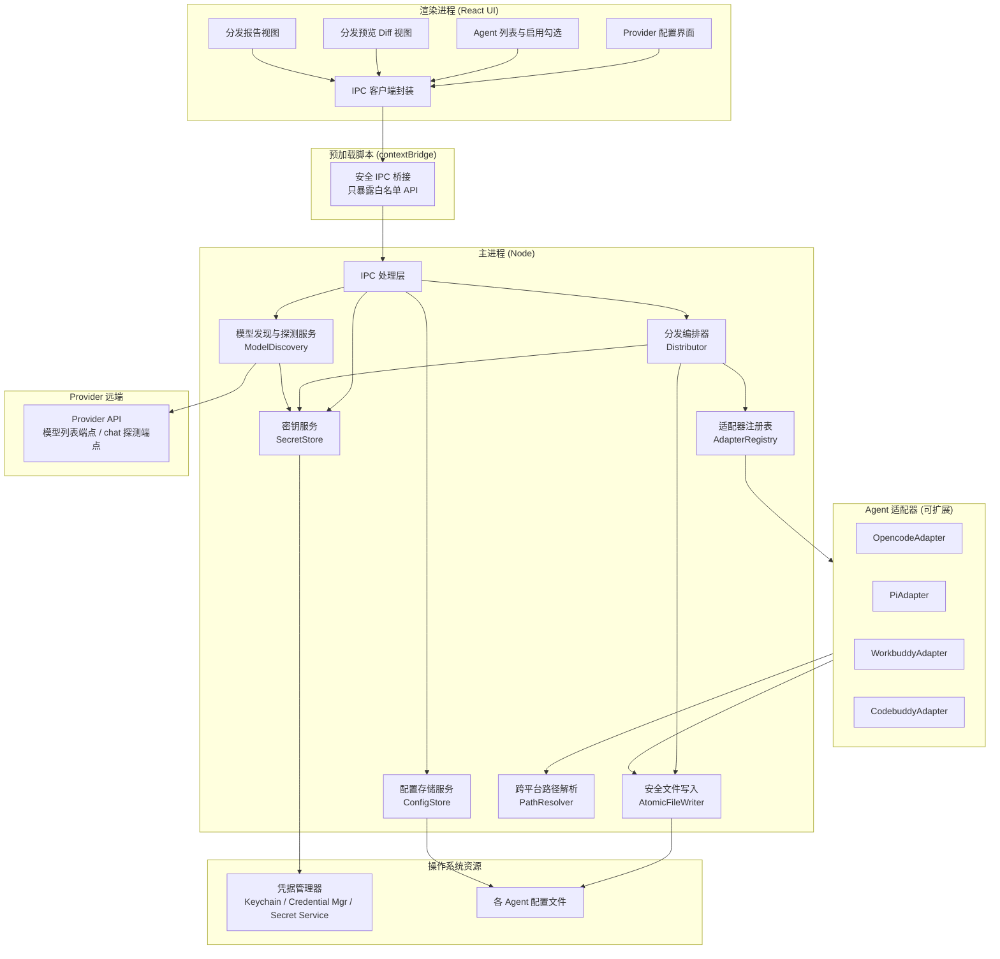
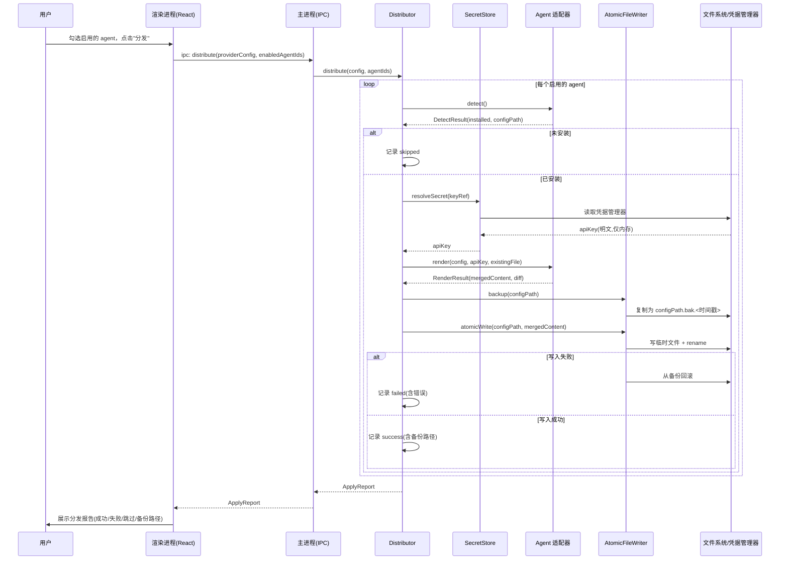
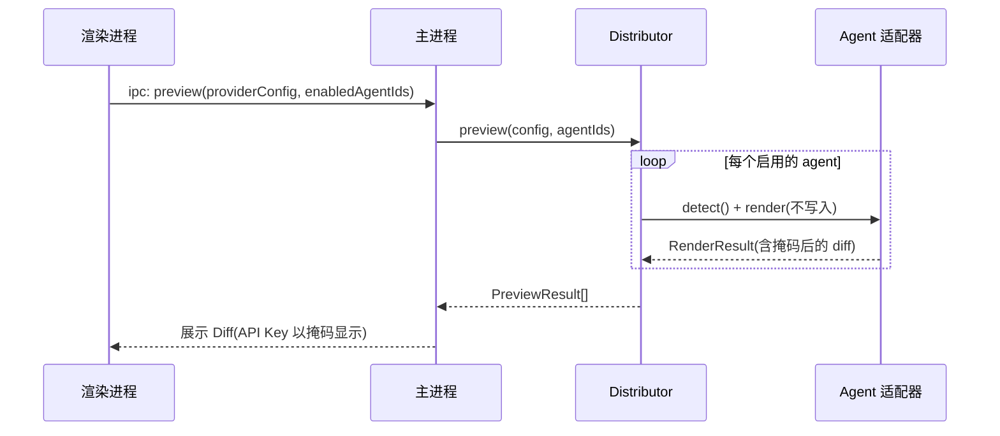
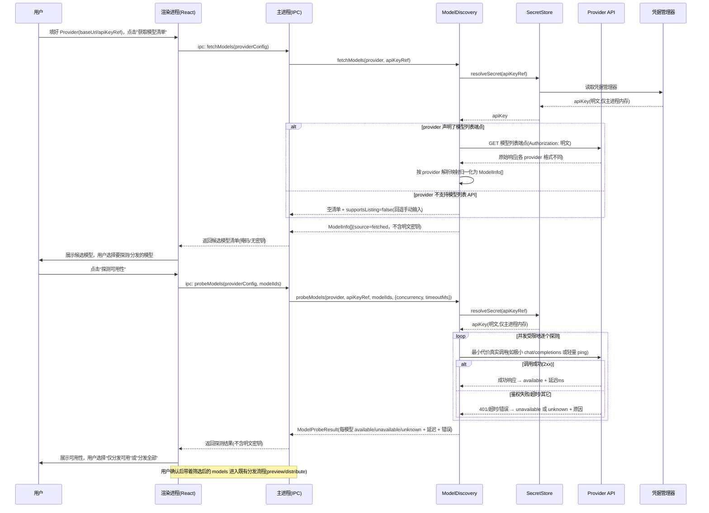

# 设计文档：LLM 配置管理器（llm-config-manager）

## Overview

本功能是一个跨平台桌面应用，用于集中管理大模型（LLM）的 API 配置（Provider：base URL、API Key、模型列表、超时、代理等），并将这些配置一键分发到多个本地 AI Agent（首批支持 opencode、pi、workbuddy、codebuddy）。用户在统一界面维护一份"配置真相"（source of truth），勾选需要启用的 agent，然后点击分发，程序负责把配置安全地写入每个 agent 各自平台、各自格式的配置文件中。

应用采用 TypeScript + Electron + React。Electron **主进程**（Node 环境）负责一切敏感与底层操作：文件系统读写、操作系统凭据管理器访问、各 agent 适配器的探测与执行；**渲染进程**（React UI）只负责界面与交互，所有敏感操作通过 IPC 委托给主进程完成。渲染进程 UI 一律基于 **Ant Design（antd v5）组件库**构建，不自行手写等价的基础/复合组件；整体视觉采用 antd 默认主题（通过 `ConfigProvider` + `theme` design token 统一，如主色 `#1677ff`、圆角 6px），页面布局、信息架构与交互参照项目已完成的 pencil 设计稿（`ui.pen`）。API Key 永不明文落盘，而是存入操作系统凭据管理器（Windows Credential Manager / macOS Keychain / Linux Secret Service），配置文件中只保存对密钥的"引用"。

架构的核心是 **Agent 适配器抽象（Agent Adapter）**：每个 agent 实现一份适配器（探测安装、解析配置路径、渲染预览、字段级合并写入），新增 agent 只需新增一份适配器与一份"格式映射描述"，不改动核心分发逻辑。由于 opencode/pi/workbuddy/codebuddy 的具体配置文件 schema 可能随版本变化，适配器的字段映射被设计为**数据驱动、可配置、可扩展**，而非硬编码假设。

**Provider 层平台覆盖**：Provider 层开箱支持主流 LLM 云平台（OpenAI、Azure OpenAI、Anthropic、Google Gemini、AWS Bedrock，以及 Mistral、Cohere、DeepSeek、xAI、Groq、Together、OpenRouter、Fireworks、Perplexity、阿里云百炼/DashScope、智谱 GLM、月之暗面 Moonshot、百度文心、火山引擎豆包、硅基流动 SiliconFlow 等）与**本地部署/自托管推理服务**（Ollama、LM Studio、vLLM、llama.cpp server、LocalAI、text-generation-webui 等），并可通过声明式预设（内置 Provider Presets）扩展到任意兼容平台，无需改动核心拉取与探测引擎。这把既有"可扩展"的能力明确落实为"开箱支持主流平台 + 本地"。

**本地部署的特有考量**：本地/自托管平台通常 `baseUrl` 指向 `localhost` 或自定义内网主机（而非公网域名）、可能**无需 API Key**（`apiKeyRef` 可为空、鉴权方式为"无鉴权"）、探测应能在离线/内网环境工作，且超时策略可与公网不同（本地延迟低、但服务未启动时应快速失败而非长时间等待）。相应地，当 provider 被标记为本地/无鉴权时，ProviderConfig 的校验规则放宽：允许 `apiKeyRef` 为空（详见 Data Models 的校验规则）。此外，云平台中 AWS Bedrock 使用 SigV4 签名鉴权，无法用简单的 header/query 模板表达，需要代码级的专门 auth 适配器（详见 AuthInjection 扩展）。

---

## Architecture

### 进程与模块划分



> **ModelDiscovery 在架构中的位置**：模型发现与探测服务位于主进程，与 Distributor、SecretStore 平级。它通过 SecretStore 解析明文密钥（仅主进程内存使用），向 Provider 远端的"模型列表端点"与"轻量探测端点"发起只读请求，把结果（含可用性与延迟）经 IPC 以**不含明文密钥**的形式回传渲染进程，供用户选择后进入既有的分发流程。它复用但不改变现有的 Agent 适配器、字段级合并、原子写入与一键分发设计——它只负责"产出一份更可信的 `models` 清单"，交由 ProviderConfig 继续走原分发链路。

### 关键设计决策与理由

| 决策 | 理由 |
| --- | --- |
| 敏感操作全部置于主进程 | 渲染进程可能加载远程内容，暴露 Node 能力有安全风险；文件系统与密钥访问必须在受信任的主进程完成。 |
| API Key 存入 OS 凭据管理器 | 避免明文落盘，符合最小暴露原则；配置文件只存密钥引用（keyRef），泄露配置文件不等于泄露密钥。 |
| 适配器格式映射数据驱动 | 各 agent 配置 schema 不稳定、可能随版本变化，硬编码会导致频繁改代码；用映射描述 + 通用引擎可快速适配新版本/新 agent。 |
| 字段级合并而非整文件覆盖 | agent 配置文件常混有用户的非 API 设置（主题、快捷键、MCP 等），整文件覆盖会丢失用户数据。 |
| key 的 agent 差异在适配器内转换，不污染 ProviderConfig | 各 agent 对"供应商 key / provider 凭据"的字段名、放置位置、引用形式（明文/env/独立 secrets）、格式封装各不相同；若让 ProviderConfig 为每个 agent 的 key 写法保留字段，统一真相会被 agent 细节污染且难以扩展。故 ProviderConfig 只持中立的 `apiKeyRef`，所有 key 适配收敛到各 `AgentAdapter.render`，优先用声明式 `CredentialMapping` 覆盖，特殊封装用 `transform` 兜底。 |
| 原子写入 + 时间戳备份 + 回滚 | 写入中途失败或程序崩溃不能损坏用户既有配置；可追溯、可恢复。 |
| 模型发现与探测置于主进程 | 拉取与探测都需使用明文密钥，必须在受信任的主进程完成；渲染进程只拿到不含密钥的结果，与"敏感操作全在主进程"原则一致。 |
| 模型列表端点与解析映射数据驱动 | 各 provider 的模型列表 API 路径与响应结构各异（OpenAI 的 `/v1/models` 返回 `data[].id`，Anthropic 等各不相同），沿用 FormatMapping 的数据驱动思路声明，可扩展新 provider 而不改核心逻辑。 |
| 探测用最小代价真实调用 + 并发/超时限制 | 仅凭模型是否出现在列表中不代表当前可调用（配额、下线、权限）；用一次极小真实调用判定真实可用性，同时限制并发与单模型超时，避免对远端造成压力或长时间阻塞。 |

---

## 时序图（Sequence Diagrams）

### 主流程：一键分发配置



### 预览流程：分发前的 Diff 预览



### 新增流程：自动获取模型清单 + 探测可用性



---

## Components and Interfaces

### 组件 1：AdapterRegistry（适配器注册表）

**职责**：维护所有已注册的 Agent 适配器；提供按 id 查询、列出全部、注册新适配器的能力。新增 agent 支持时在此注册，核心分发逻辑无需改动。

```typescript
/** 适配器注册表：集中管理所有 Agent 适配器，支持扩展 */
interface AdapterRegistry {
  /** 注册一个适配器（启动时或插件加载时调用） */
  register(adapter: AgentAdapter): void;
  /** 按 agent 唯一 id 获取适配器；不存在返回 undefined */
  get(agentId: string): AgentAdapter | undefined;
  /** 列出所有已注册适配器（用于 UI 展示可管理的 agent 列表） */
  list(): AgentAdapter[];
}
```

### 组件 2：AgentAdapter（Agent 适配器抽象 —— 架构核心）

**职责**：为单个 agent 封装"探测安装状态、解析各平台配置路径、渲染预览、字段级合并写入"四类能力。所有 agent 实现同一接口，新增 agent 不触碰核心逻辑。

```typescript
/** Agent 适配器统一接口：每个受支持的 agent 实现一份 */
interface AgentAdapter {
  /** agent 唯一标识，如 "opencode" / "pi" / "workbuddy" / "codebuddy" */
  readonly id: string;
  /** 展示名称，用于 UI */
  readonly displayName: string;

  /**
   * 探测该 agent 是否安装、配置文件在哪
   * @param platform 当前运行平台信息
   * @returns 是否安装、解析出的配置文件绝对路径、是否已存在该文件
   */
  detect(platform: PlatformContext): Promise<DetectResult>;

  /**
   * 返回该 agent 在当前平台的配置文件绝对路径
   * （内部使用 PathResolver 处理 ~、%APPDATA%、$XDG_CONFIG_HOME 等）
   */
  configPath(platform: PlatformContext): string;

  /**
   * 渲染：把统一的 ProviderConfig 映射为该 agent 的配置内容，
   * 与现有文件内容做"字段级合并"，但不写入磁盘。
   *
   * 【密钥适配是 render 的固有职责之一】
   * 各 agent 对"供应商 API Key / provider 凭据"的定义与表达方式可能各不相同
   * （字段名 apiKey/api_key/key/token/authToken 不一；放置位置在 provider 块内/顶层/
   * 按模型维度/独立 credentials 段不一；引用方式明文/环境变量引用/占位符不一；
   * 格式可能需要前缀、base64 或连接串拼装）。这些差异**必须在本方法（render）内部完成转换**，
   * **不得污染统一的 ProviderConfig**——ProviderConfig 保持供应商中立、与 agent 无关，
   * 只持有 apiKeyRef 等中立字段，不为任何特定 agent 的 key 写法保留字段。
   * render 接收中立的 `config` + 解析出的明文 `apiKey`，由适配器负责把 key 转换成
   * **该 agent 要求的字段名、位置、引用形式与格式**，再做字段级合并。
   * 具体转换优先由数据驱动的 `FormatMapping.credential`（声明式）描述；无法用声明表达的
   * 特殊封装（base64、签名、连接串等）由 `mapping.transform` 钩子在适配器代码里兜底（少数特例）。
   *
   * @param config 统一 Provider 配置（供应商中立，仅含 apiKeyRef，不含任何 agent 专属的 key 字段）
   * @param apiKey 解析出的明文密钥（仅内存传递）
   * @param existingContent 现有配置文件原始文本（不存在则为 null）
   * @returns 合并后的完整文件文本 + 供预览的差异（API Key 已掩码；
   *          若该 agent 采用 env/独立 secrets 文件引用，diff 显示引用占位而非明文）
   */
  render(
    config: ProviderConfig,
    apiKey: string,
    existingContent: string | null,
  ): RenderResult;

  /**
   * 应用：把 render 产出的内容写入磁盘（经由 AtomicFileWriter，
   * 含备份与回滚）。通常由 Distributor 调用而非适配器自行写。
   */
  apply(
    configPath: string,
    renderResult: RenderResult,
    writer: AtomicFileWriter,
  ): Promise<ApplyEntry>;
}
```

**可扩展/数据驱动说明**：各 agent 的具体字段映射不写死在适配器逻辑里，而是由一份**映射描述（FormatMapping）**驱动。适配器基类读取映射描述完成通用的"读→合并→序列化"流程，个性化部分（如嵌套路径、特殊字段名）由描述声明。这样调整 opencode/pi/workbuddy/codebuddy 的字段只需改描述，必要时才落到代码。

```typescript
/** 配置文件序列化格式 */
type ConfigFormat = "json" | "jsonc" | "toml" | "yaml";

/**
 * 格式映射描述：声明如何把统一 ProviderConfig 的字段
 * 映射到某个 agent 配置文件的具体位置（数据驱动，可配置）
 */
interface FormatMapping {
  /** 配置文件格式 */
  format: ConfigFormat;
  /**
   * 字段映射表：键为统一模型字段路径，值为目标文件中的 JSON 指针式路径。
   * 例如 { "baseUrl": "/provider/{providerName}/options/baseURL" }
   */
  fieldPaths: Record<string, string>;
  /** 该 agent 配置中「受本程序管理」的字段路径集合（合并时只动这些） */
  managedPaths: string[];
  /**
   * 可选：凭据注入的声明式描述（数据驱动，向后兼容——不声明时沿用 fieldPaths 里对
   * key 字段的直接明文映射）。用于覆盖**大多数** agent 对 key 字段名/位置/引用形式/
   * 格式的差异，使 ProviderConfig 无需为任何 agent 的 key 写法保留字段。
   * 无法用声明表达的特殊封装（base64、签名、连接串拼装等）仍走下方 `transform` 钩子。
   */
  credential?: CredentialMapping;
  /**
   * 可选的自定义变换钩子名（用于无法用路径/声明表达的特殊情况，
   * 包括 key 的特殊封装：base64、签名、provider+key 连接串等——属少数特例）。
   */
  transform?: string;
}
```

**凭据注入的数据驱动声明（CredentialMapping）**：各 agent 对 key 的表达差异（字段名、位置、引用形式、值模板、以及引用形式下密钥的实际存放处）用一份声明式 `CredentialMapping` 覆盖大多数情况。它只描述"key 写到哪、以什么形态写、值长什么样、若走引用则密钥实际落到哪"，由适配器基类的通用引擎在 render 阶段执行，新增/调整 agent 的 key 写法通常只改声明、不改代码。

```typescript
/**
 * 凭据字段形态：决定 key 以何种形式出现在该 agent 的配置文件中。
 * - "inline"：直接写入明文 key（能走环境变量/独立 secrets 的优先于明文，见 Security Considerations）
 * - "env"：配置文件里写环境变量引用（如 "{env:VAR}" / "${VAR}"），明文落到环境变量/.env
 * - "secrets-file"：配置文件里写对独立 secrets 文件的引用，明文落到该 secrets 文件
 */
type CredentialForm = "inline" | "env" | "secrets-file";

/**
 * 凭据注入声明：描述把供应商 key 适配成**该 agent 要求**的字段名、位置、引用形式与格式。
 * 由各 AgentAdapter 在 render 阶段数据驱动地应用；本结构不进入 ProviderConfig，
 * 从而保证 ProviderConfig 的供应商中立与 agent 无关性。
 */
interface CredentialMapping {
  /**
   * 目标路径：key（或其引用）写到该 agent 配置文件哪个 JSON 指针式位置。
   * 覆盖"字段名不同 + 放置位置不同"两类差异，例如：
   * "/provider/{providerName}/options/apiKey"（provider 块内）、
   * "/api_key"（顶层、下划线命名）、"/secrets/token"（独立 credentials 段）。
   */
  targetPointer: string;
  /** 字段形态：inline 明文 / env 引用 / secrets 文件引用 */
  form: CredentialForm;
  /**
   * 值模板：写入 targetPointer 的字符串模板。
   * - inline：如 "{key}" 或带前缀 "Bearer {key}"（覆盖"格式/封装"差异的简单情形）
   * - env：如 "{env:ANTHROPIC_API_KEY}" 或 "${ANTHROPIC_API_KEY}"（覆盖"引用方式"差异）
   * - secrets-file：如对独立文件中条目的引用占位
   * 占位符：{key}=明文密钥，{env:VAR}/{VAR}=环境变量引用，{providerName}=provider 名。
   */
  valueTemplate: string;
  /**
   * 当 form="env" 时，明文密钥实际写入的环境变量名（如 "ANTHROPIC_API_KEY"）。
   * 适配器负责把明文写到该环境变量/该 agent 读取的 .env 文件，配置文件里只留引用。
   */
  envVarName?: string;
  /**
   * 当 form="secrets-file" 时，明文密钥实际写入的独立 secrets 文件路径（可含平台变量，
   * 由 PathResolver 解析）与文件内的条目键；配置文件里只留对它的引用。
   */
  secretsFile?: { path: string; entryKey: string };
}
```

> **安全优先级（与 Security Considerations 一致）**：本程序原则是"能走环境变量 / 独立 secrets 文件的优先于写进明文配置文件"。具体采用 `inline` / `env` / `secrets-file` 中的哪一种，由各 agent 适配器**根据该 agent 支持的能力**在其 `CredentialMapping` 中声明——若该 agent 支持 env/独立文件引用，则优先采用引用形态，明文不落入配置文件本身。

### 组件 3：Distributor（分发编排器）

**职责**：编排一次分发的完整流程——对每个启用的 agent 依次执行 detect → 解析密钥 → render → 备份 → 原子写入 → 回滚（失败时），汇总为 ApplyReport。单个 agent 失败不影响其他 agent（隔离）。

```typescript
interface Distributor {
  /** 仅预览：对启用的 agent 生成合并结果与差异，不写盘 */
  preview(config: ProviderConfig, agentIds: string[]): Promise<PreviewResult[]>;
  /** 执行分发：写盘并返回报告 */
  distribute(config: ProviderConfig, agentIds: string[]): Promise<ApplyReport>;
}
```

### 组件 4：SecretStore（密钥服务）

**职责**：封装对操作系统凭据管理器的读写。API Key 以 keyRef 为索引存取；对外只暴露引用，明文仅在分发瞬间于主进程内存中短暂存在。

```typescript
interface SecretStore {
  /** 保存密钥，返回引用（keyRef），供配置中引用 */
  saveSecret(keyRef: string, apiKey: string): Promise<void>;
  /** 按引用解析出明文密钥（仅主进程内存使用，不回传渲染进程） */
  resolveSecret(keyRef: string): Promise<string | null>;
  /** 删除密钥 */
  deleteSecret(keyRef: string): Promise<void>;
  /** 返回用于 UI 展示的掩码（如 "sk-****abcd"），从不回传明文 */
  getMasked(keyRef: string): Promise<string | null>;
}
```

### 组件 5：ConfigStore（配置存储服务）

**职责**：持久化本程序自身的状态——Provider 配置列表、各 agent 的启用状态等（不含明文密钥）。存于应用自有数据目录。

```typescript
interface ConfigStore {
  loadAppState(): Promise<AppState>;
  saveAppState(state: AppState): Promise<void>;
}
```

### 组件 6：PathResolver（跨平台路径解析）

**职责**：把含有平台变量的路径模板解析为当前平台的绝对路径，正确处理 `~`、`%APPDATA%`、`%ProgramData%`、`$XDG_CONFIG_HOME` 等。

```typescript
interface PathResolver {
  /** 把路径模板按当前平台展开为绝对路径 */
  resolve(template: string, platform: PlatformContext): string;
  /** 各平台的配置根目录（XDG config home / AppData / ~/.config 等） */
  configHome(platform: PlatformContext): string;
}
```

### 组件 7：AtomicFileWriter（安全文件写入）

**职责**：提供带时间戳备份、临时文件 + 原子 rename、失败回滚的文件写入能力。

```typescript
interface AtomicFileWriter {
  /** 为目标文件创建带时间戳的备份，返回备份路径（文件不存在则返回 null） */
  backup(targetPath: string): Promise<string | null>;
  /** 原子写入：写入临时文件再 rename 覆盖目标，保证中途失败不损坏原文件 */
  atomicWrite(targetPath: string, content: string): Promise<void>;
  /** 从指定备份恢复目标文件 */
  restore(backupPath: string, targetPath: string): Promise<void>;
}
```

### 组件 8：ModelDiscovery（模型发现与探测服务）

**职责**：位于主进程，负责"基于 API 自动获取模型清单"与"探测模型可用性"两类能力。它通过 SecretStore 解析明文密钥（仅主进程内存），按 provider 声明的"模型列表端点配置"拉取并归一化模型清单，并以最小代价的真实调用逐个探测模型可用性（带并发与超时控制）。所有对外（渲染进程）回传的结果均**不含明文密钥**；对 provider 远端只做**只读**访问，不产生任何配置副作用。

```typescript
/** 模型发现与探测服务：主进程组件，产出可信的 models 清单供分发 */
interface ModelDiscovery {
  /**
   * 拉取某 provider 当前可用的模型清单。
   * 内部：resolveSecret(apiKeyRef) → 按 provider 的 modelListing 配置请求端点
   *       → 用 responseMapping 把原始响应归一化为 ModelInfo[]。
   * @param provider 统一 Provider 配置（含 apiKeyRef 与可选的 modelListing 配置）
   * @returns 候选模型清单（source="fetched"）；provider 不支持列表 API 时返回空清单
   * @remarks 返回内容不含明文密钥；仅做只读 GET，不写任何配置
   */
  fetchModels(provider: ProviderConfig): Promise<FetchModelsResult>;

  /**
   * 探测单个模型的可用性：用最小代价的真实调用判定。
   * @param provider 统一 Provider 配置
   * @param modelId 待探测的模型 id
   * @param options 超时等控制
   * @returns 单模型探测结果（available/unavailable/unknown + 延迟 + 错误原因）
   */
  probeModel(
    provider: ProviderConfig,
    modelId: string,
    options?: ProbeOptions,
  ): Promise<ModelProbeResult>;

  /**
   * 批量探测：对一组模型并发探测，受并发上限与单模型超时约束。
   * @param provider 统一 Provider 配置
   * @param modelIds 待探测模型 id 列表
   * @param options 并发上限、单模型超时
   * @returns 与 modelIds 一一对应的探测结果集合
   * @remarks 探测只读、无副作用；结果不含明文密钥
   */
  probeModels(
    provider: ProviderConfig,
    modelIds: string[],
    options?: ProbeOptions,
  ): Promise<ModelProbeResult[]>;
}

/** 探测控制参数 */
interface ProbeOptions {
  /** 单个模型探测的超时（毫秒），默认如 8000 */
  timeoutMs?: number;
  /** 并发上限（同时进行的探测请求数），默认如 4 */
  concurrency?: number;
}

/** fetchModels 结果：区分"成功拉取"与"provider 不支持列表 API 需回退手动" */
interface FetchModelsResult {
  /** 该 provider 是否支持模型列表 API（false 时提示用户回退手动输入） */
  supportsListing: boolean;
  /** 归一化后的候选模型清单（source="fetched"） */
  models: ModelInfo[];
  /** 拉取失败/部分失败的说明（端点不可达、格式非预期等），成功时为空 */
  warning?: string;
}
```

**数据驱动/可扩展说明**：不同 provider 的模型列表 API 路径与响应结构各异。沿用 `FormatMapping` 的思路，在 provider 层声明一份 **`ModelListingConfig`**（端点路径、HTTP 方法、鉴权注入方式、响应中模型数组的指针、模型 id 字段名），ModelDiscovery 用通用引擎按该声明拉取与解析，**新增 provider 只需补一份声明**，核心逻辑不改。探测端点（轻量 chat/ping）同理由 `ModelProbeConfig` 声明。

```typescript
/**
 * 模型列表端点配置（数据驱动，声明如何从某 provider 拉取与解析模型清单）
 */
interface ModelListingConfig {
  /** 相对 baseUrl 的端点路径，如 "/v1/models"；缺省表示该 provider 不支持列表 API */
  path?: string;
  /** HTTP 方法，默认 "GET" */
  method?: "GET" | "POST";
  /** 鉴权注入方式：决定把密钥放到 Header 还是 Query */
  auth: AuthInjection;
  /** 响应解析映射：从原始 JSON 定位模型数组与字段 */
  responseMapping: ModelListingResponseMapping;
}

/** 鉴权注入方式（不同 provider 不同） */
interface AuthInjection {
  /**
   * 注入位置：
   * - "header"：把密钥注入请求头（如 Authorization / x-api-key / api-key）
   * - "query"：把密钥注入查询参数（如 Google Gemini 的 ?key={key}）
   * - "none"：无鉴权（本地/自托管场景，如 Ollama / LM Studio / vLLM 默认无需密钥）
   */
  in: "header" | "query" | "none";
  /**
   * 鉴权种类（可选，用于显式区分表达方式与特例）：
   * - "bearer"：Authorization: Bearer {key}（OpenAI 及多数兼容平台）
   * - "header"：任意自定义头注入 {key}（如 Anthropic 的 x-api-key、Azure 的 api-key）
   * - "query"：查询参数注入 {key}（如 Gemini ?key=）
   * - "none"：无鉴权（本地场景，apiKeyRef 可为空）
   * - "sigv4"：AWS SigV4 签名鉴权，无法用简单 header/query 模板表达，
   *            由专门的代码级 auth 适配器处理（见下方说明），属少数特例。
   * 缺省时由 in + name + valueTemplate 推断（保持与现有字段兼容）。
   */
  kind?: "bearer" | "header" | "query" | "none" | "sigv4";
  /** 头/参数名，如 "Authorization" / "x-api-key" / "api-key"；in="none"/kind="sigv4" 时可省略 */
  name?: string;
  /** 值模板，用 {key} 占位明文密钥，如 "Bearer {key}" 或 "{key}"；in="none"/kind="sigv4" 时可省略 */
  valueTemplate?: string;
  /** 额外固定头（如 Anthropic 的 anthropic-version、Azure 的 api-version 查询） */
  extraHeaders?: Record<string, string>;
}

/** 模型列表响应解析映射（JSON 指针式，数据驱动） */
interface ModelListingResponseMapping {
  /** 指向响应中"模型数组"的指针，如 "/data"（OpenAI）或 "/models"（其它） */
  arrayPointer: string;
  /** 数组元素中模型 id 的字段名，如 "id" 或 "name" */
  idField: string;
}

/**
 * 模型探测端点配置（数据驱动，声明如何对该 provider 做最小代价探测）
 */
interface ModelProbeConfig {
  /** 探测端点路径，如 "/v1/chat/completions" */
  path: string;
  method?: "GET" | "POST";
  auth: AuthInjection;
  /**
   * 请求体模板：用 {model} 占位模型 id；构造"最小代价"请求
   * 例如 { model: "{model}", messages: [{role:"user",content:"ping"}], max_tokens: 1 }
   */
  bodyTemplate?: Record<string, unknown>;
  /** 判定为"可用"的 HTTP 状态码集合，默认 2xx */
  availableStatuses?: number[];
}
```

**AuthInjection 扩展说明（无鉴权与特殊签名鉴权）**：

- **无鉴权（本地场景）**：本地/自托管推理服务（Ollama、LM Studio、vLLM、llama.cpp server、LocalAI、text-generation-webui 等）通常无需 API Key。此时声明 `auth: { in: "none" }`（可选 `kind: "none"`），注入引擎检测到 `in="none"` 即**不读取也不要求任何密钥**，`name`/`valueTemplate` 省略，`apiKeyRef` 允许为空。这是最小侵入的表达：现有 `in="header" | "query"` 的声明完全不受影响。
- **特殊签名鉴权（AWS SigV4）**：AWS Bedrock 使用 SigV4 对整个请求（方法、路径、头、载荷、时间戳）做派生签名，**无法用简单的 header/query 值模板表达**。对这类特例，声明 `auth: { kind: "sigv4" }`，由一个**专门的代码级 auth 适配器**（而非数据驱动模板）在 `injectAuth` 阶段接管签名计算，复用 `ModelListingConfig`/`ModelProbeConfig` 的请求构造与既有的 `transform`/钩子扩展点。设计上明确：**SigV4 是少数需要代码级适配器的特例**，绝大多数云平台与全部本地平台都能用声明式 `AuthInjection` 覆盖，不破坏"预设数据驱动"的主路径。

> 注入引擎在 `injectAuth(req, auth, apiKey)` 中按 `auth.in`/`auth.kind` 分派：`none` → 跳过注入；`header`/`query`/`bearer` → 按模板注入 `{key}`；`sigv4` → 委托专用签名适配器。该分派对现有预设向后兼容（未声明 `kind` 时按 `in` 推断）。

### 内置预设（Provider Presets）

为把"可扩展"落实为"开箱即用"，系统内置一组 **Provider 预设**：每个预设是一份声明式的 `{ baseUrl 默认值, AuthInjection, ModelListingConfig, ModelProbeConfig }` 模板，用户新建 Provider 时选择平台即自动套用，核心拉取/探测引擎对预设**完全数据驱动**（除 SigV4 特例外无需改代码）。下表列出开箱内置的预设（高度同质的 OpenAI 兼容平台归组举例；本地平台因端点/鉴权不同而分别点名）。

| 平台 | API 风格 | 鉴权方式（AuthInjection 概要） | 模型列表端点（path / arrayPointer / idField） | 探测端点（path） |
| --- | --- | --- | --- | --- |
| OpenAI | OpenAI 兼容 | `Authorization: Bearer {key}`（header, kind=bearer） | `/v1/models` / `/data` / `id` | `/v1/chat/completions` |
| Azure OpenAI | 原生（deployment 维度） | `api-key: {key}`（header, kind=header）+ `api-version` 查询 | 列表端点特殊：按资源列 deployment（如 `/openai/deployments?api-version=...`，arrayPointer 视响应而定 `/data`，idField `id`/`model`）；见下方差异说明 | `/openai/deployments/{deployment}/chat/completions?api-version=...` |
| Anthropic | 原生 | `x-api-key: {key}` + `anthropic-version: 2023-06-01`（header, kind=header, extraHeaders） | `/v1/models` / `/data` / `id` | `/v1/messages` |
| Google Gemini | 原生 | API key 查询参数 `?key={key}`（query, kind=query）或 `x-goog-api-key` header | `/v1beta/models` / `/models` / `name` | `/v1beta/models/{model}:generateContent` |
| AWS Bedrock | 原生 | **SigV4 签名鉴权**（kind=sigv4，代码级适配器，非简单 header）| `ListFoundationModels`（控制面 API，arrayPointer `/modelSummaries`，idField `modelId`） | `InvokeModel`（运行时端点，SigV4 签名） |
| OpenAI 兼容云平台组：Mistral、Cohere*、DeepSeek、xAI(Grok)、Groq、Together、OpenRouter、Fireworks、Perplexity | OpenAI 兼容 | `Authorization: Bearer {key}`（header, kind=bearer） | `/v1/models` / `/data` / `id` | `/v1/chat/completions` |
| 国内云平台组：阿里云百炼/DashScope、智谱 GLM、月之暗面 Moonshot、百度文心、火山引擎豆包、硅基流动 SiliconFlow | 多为 OpenAI 兼容（部分原生） | 多为 `Authorization: Bearer {key}`；差异见下方说明 | OpenAI 兼容路径 `/v1/models` / `/data` / `id`（原生接口按各自声明） | `/v1/chat/completions`（兼容模式） |
| **Ollama**（本地） | 原生（含 OpenAI 兼容层） | **无鉴权**（in=none，`apiKeyRef` 可空） | `/api/tags` / `/models` / `name` | `/api/show`（或 `/api/chat` 最小调用） |
| **LM Studio**（本地） | OpenAI 兼容 | **无鉴权**（in=none） | `/v1/models` / `/data` / `id` | `/v1/chat/completions` |
| **vLLM / llama.cpp server / LocalAI / text-generation-webui**（本地） | OpenAI 兼容 | **无鉴权**（in=none）或自定义 token（header, kind=header/bearer） | `/v1/models` / `/data` / `id` | `/v1/chat/completions` |

> **归组说明**：OpenAI 兼容云平台组与国内云平台组内部高度同质（`/v1/models` + Bearer + `/data[].id`），仅 baseUrl 与密钥不同，故合并举例而非逐个成行；真正的差异靠各自预设里的 `baseUrl` 与 `AuthInjection` 吸收。本地三类平台因端点路径（`/api/tags` vs `/v1/models`）与鉴权（无鉴权 vs 自定义 token）不同，分别点名。
>
> **各预设差异要点**：
> - **Azure OpenAI**：按 *deployment* 而非 model 组织，鉴权头为 `api-key`（非 `Authorization`），且几乎所有端点都要求 `api-version` 查询参数；模型"列表"实为列出资源下的 deployments，路径与标准 `/v1/models` 不同，预设里用专门的 `path` + `responseMapping` 声明，探测端点需带 `{deployment}` 与 `api-version`。
> - **Google Gemini**：密钥默认走查询参数 `?key={key}`（也支持 `x-goog-api-key` header）；列表数组在 `/models`、模型标识字段是 `name`（形如 `models/gemini-...`），与 OpenAI 的 `/data[].id` 不同。
> - **AWS Bedrock**：SigV4 签名鉴权，`kind=sigv4` 走代码级适配器；"模型列表"与"调用"分属控制面（`ListFoundationModels`）与运行时（`InvokeModel`）不同端点，属需要专门适配的少数特例。
> - **Cohere（\*）**：聊天/模型接口为原生风格（如 `/v1/models`、`/v2/chat`），鉴权为 `Authorization: Bearer {key}`，可用声明式预设覆盖，归入兼容组举例但其探测体模板按原生接口声明。
> - **国内平台**：DashScope/智谱/Moonshot/SiliconFlow 等多提供 OpenAI 兼容端点（`/v1/...` + Bearer），可直接复用兼容预设；百度文心、火山引擎豆包部分接口为原生鉴权（如 AK/SK 或独立 token），这类在预设的 `AuthInjection` 里声明对应 header/query 即可，无需改引擎。
>
> **扩展方式**：新增任意兼容平台只需追加一份预设声明（上述四元组），无需改动 `ModelDiscovery` 的拉取/探测引擎；唯一的代码级例外是 SigV4（Bedrock）这类签名鉴权。

### UI 组件与设计稿映射（UI Components & Design Reference）

**组件选型总则**：渲染进程 UI **一律使用 Ant Design（antd v5）现成组件**，不自行手写等价的基础/复合组件（按钮、表单、表格、弹窗、标签、开关等均直接取用 antd）。图标统一使用 `@ant-design/icons`（替代设计稿中 lucide 风格图标）。UI 的布局、信息架构与交互以项目已完成的 pencil 设计稿（`ui.pen`）为**权威参照**——该设计稿已统一到 antd 默认视觉风格（主色 `#1677ff`、圆角 6px、系统/Inter 字体、antd 语义色），含四个画布：**主界面**、**Preview Diff 弹窗**、**分发报告弹窗**、**Add Provider 弹窗**。antd 组件按设计稿的信息架构组织，**不要为了套用组件而偏离设计稿的结构**。

**关键界面区域 → antd 组件映射表**：

| 界面区域（参照 ui.pen 画布） | antd 组件 | 说明 |
| --- | --- | --- |
| 整体三栏布局（主界面） | `Layout`（`Sider` / `Content` / 可选 `Header`） | 左栏 Provider 列表、中栏详情、右栏分发面板 |
| 顶部栏 | `Layout.Header` + `Space` + `Button` | 操作按钮含图标用 `@ant-design/icons` |
| Provider 列表（左栏） | `Menu` 或 `List` | 选中态高亮；带连接/可用状态点用 `Badge` / `Tag` |
| Provider 详情表单（中栏） | `Form` + `Input` / `Input.Password` / `InputNumber` / `Select` | API Key 掩码用 `Input.Password`；timeout 用 `InputNumber`；鉴权方式/本地标记等用 `Select` |
| 模型表格（模型 id / 来源 / 可用性 / 延迟 / 勾选） | `Table`（`rowSelection`） | 勾选用 `rowSelection`；可用性用 `Tag`（available/unavailable/unknown 对应 antd 语义色）；延迟列展示 `latencyMs` |
| 模型发现 / 探测动作 | `Button`（Fetch list / Probe availability） + `Segmented` 或 `Radio.Group` | 筛选 available-only / all 用 `Segmented`/`Radio.Group` |
| Agent 分发面板（右栏） | `Card` / `List` + `Switch` + `Badge` | `Switch` 为启用开关；`Badge` 表示安装/探测状态 |
| 一键分发 / 预览 | `Button`（`type="primary"`） | 主操作用主按钮；预览为次级按钮 |
| Add Provider / Preview Diff / 分发报告 | `Modal` 或 `Drawer` | 对应三个弹窗画布 |
| 平台预设选择（Add Provider 弹窗） | `Segmented` / `Tabs` + `Tag` | 云/本地分组；预设用 `Tag` 标注 |
| 分发报告（分发报告弹窗） | `Statistic` / `Tag` + `List` + `Result` 或 `Alert` | 成功/失败/跳过计数用 `Statistic`/`Tag`，明细用 `List`，整体结论用 `Result` 或 `Alert` |
| Diff 预览（Preview Diff 弹窗） | `Typography.Text code` / `<pre>` 等宽容器 | 用等宽文本容器展示；增删行用语义色标注；承接 `maskedDiff`（API Key 已掩码） |
| 图标 | `@ant-design/icons` | 统一替代设计稿中 lucide 图标 |
| 加载 / 探测中 | `Spin` / `Button loading` / `Progress` | fetch/probe 进行中态 |
| 表单校验错误 | `Form` 的 `rules` + `Form.Item` 校验态 | 承接 `validate()` 的逐项错误（见 Data Models 校验规则） |
| 全局消息 / 通知 | `message` / `notification` | 分发成功、错误告警等 |

**主题定制**：使用 antd v5 的 `ConfigProvider` + `theme`（design token）统一视觉，关键 token 如 `colorPrimary: '#1677ff'`、`borderRadius: 6`，字体沿用系统/Inter；深色模式可选用 `theme.darkAlgorithm`。所有页面在同一 `ConfigProvider` 下渲染，保证与 pencil 设计稿的 antd 默认视觉一致。

**安全要点重申（与 Property 1 一致）**：API Key 一律用 `Input.Password` 展示掩码，**明文绝不进入 React 状态**——用户输入后仅经 IPC 的 `saveSecret` 交主进程存入凭据管理器；UI 侧永远只拿到 `getMaskedSecret` 返回的掩码串，以及 `preview`/`fetchModels`/`probeModels` 等 IPC 返回的**不含明文**的结果（`maskedDiff`、`ModelInfo[]`、`ModelProbeResult[]`）。Diff 预览容器展示的也只是已掩码的 `maskedDiff`。

---

## Data Models

### 模型 1：ProviderConfig（Provider 配置，统一真相）

```typescript
/** 统一的 Provider 配置：UI 维护的「配置真相」，与具体 agent 无关 */
interface ProviderConfig {
  /** 内部唯一 id */
  id: string;
  /** Provider 名称，如 "anthropic" / "openai" / 自定义网关 */
  name: string;
  /** API 基础地址 */
  baseUrl: string;
  /** API Key 的引用（指向 OS 凭据管理器中的条目），绝不存明文 */
  apiKeyRef: string;
  /**
   * 已选用于分发的模型 id 列表（分发时写入各 agent 的就是这一组）。
   * 兼容既有字段名 `models`：原"模型列表"即为此"已选分发集合"。
   * 其元素应为 candidateModels 中 id 的子集（当使用自动获取时），
   * 或为用户手动输入的模型 id（provider 不支持列表 API 时）。
   */
  models: string[];
  /**
   * 候选模型清单：由 ModelDiscovery.fetchModels 拉取或用户手动录入，
   * 携带来源与最近一次探测状态，供 UI 展示与筛选。可选（未获取过时为空）。
   */
  candidateModels?: ModelInfo[];
  /**
   * 分发时的模型筛选策略：
   * - "available-only"：仅分发探测结果为 available 的模型
   * - "all"：分发全部已选模型（不要求探测通过）
   * 默认 "all"（保持与旧行为兼容）。
   */
  modelSelection?: "available-only" | "all";
  /**
   * 该 provider 的模型列表端点配置（数据驱动，可扩展）；
   * 缺省表示该 provider 不支持自动获取，UI 回退到手动输入 models。
   */
  modelListing?: ModelListingConfig;
  /** 该 provider 的模型探测端点配置（数据驱动，可扩展）；缺省则无法探测 */
  modelProbe?: ModelProbeConfig;
  /** 请求超时（毫秒），可选 */
  timeoutMs?: number;
  /** 代理设置，可选 */
  proxy?: ProxyConfig;
  /**
   * 是否为本地/自托管 provider（baseUrl 指向 localhost/自定义内网主机）。
   * 为 true 时通常无需 API Key，校验规则放宽：apiKeyRef 允许为空。可选，默认 false。
   */
  isLocal?: boolean;
}

interface ProxyConfig {
  url: string;
  /** 代理认证引用（如需要），同样走凭据管理器 */
  authRef?: string;
}
```

**校验规则**：
- `name` 非空；`baseUrl` 必须是合法的 http/https URL（本地场景允许指向 `localhost`/`127.0.0.1`/自定义主机与端口）。
- **鉴权相关校验（放宽）**：当 provider 标记为本地/无鉴权时（`isLocal = true`，或其 `modelListing.auth.in = "none"` / `kind = "none"`），`apiKeyRef` **允许为空**，且不要求在 SecretStore 中可解析；否则 `apiKeyRef` 非空且必须在 SecretStore 中可解析。
- `models` 至少一项；`timeoutMs`（若提供）为正整数。
- 若 `candidateModels` 非空，则其中 id 唯一；分发集合 `models` 中每个 id 均应存在于 `candidateModels` 的 id 集合中（自动获取路径下）。
- 若 `modelSelection = "available-only"`，则 `models` 中每个 id 对应的 `candidateModels` 条目 `availability` 应为 `"available"`。

### 模型 1b：ModelInfo 与 ModelProbeResult（模型发现与探测）

```typescript
/** 模型可用性状态 */
type ModelAvailability = "available" | "unavailable" | "unknown";

/** 模型来源：自动拉取 or 用户手动输入 */
type ModelSource = "fetched" | "manual";

/**
 * 单个模型的信息（候选清单的元素）：
 * 既承载"从哪来"（source），也承载最近一次探测的结论（availability 等）。
 */
interface ModelInfo {
  /** 模型 id，如 "claude-sonnet-4" / "gpt-4o-mini" */
  id: string;
  /** 来源：fetched=API 拉取；manual=用户手动输入 */
  source: ModelSource;
  /** 最近一次探测得到的可用性；未探测过为 "unknown" */
  availability: ModelAvailability;
  /** 最近一次成功探测的往返延迟（毫秒）；未探测或失败时为 undefined */
  latencyMs?: number;
  /** 探测失败/不可用时的错误信息（如 "401 未授权" / "超时"）；可用时为 undefined */
  error?: string;
  /** 最近一次探测的时间戳（ISO 字符串），便于判断结果新鲜度 */
  probedAt?: string;
}

/**
 * 单个模型的探测结果：probeModel/probeModels 的返回元素。
 * 与 ModelInfo 的探测字段对应，可用于回写 candidateModels。
 */
interface ModelProbeResult {
  /** 被探测的模型 id */
  modelId: string;
  /** 探测判定的可用性 */
  availability: ModelAvailability;
  /** 成功时的往返延迟（毫秒） */
  latencyMs?: number;
  /** 探测返回的 HTTP 状态码（若有），便于诊断 */
  statusCode?: number;
  /** 失败/不可用的原因（鉴权失败、超时、网络错误、格式异常等） */
  error?: string;
  /** 探测完成时间（ISO 字符串） */
  probedAt: string;
}
```

**校验规则**：
- `ModelInfo.id` 非空；同一 `candidateModels` 列表内 id 唯一。
- `availability = "available"` 时允许带 `latencyMs`，不应带 `error`。
- `availability ≠ "available"` 时应带可读 `error`（除 "unknown" 的"从未探测"初始态外）。

### 模型 2：AgentState（Agent 启用/状态）

```typescript
/** 单个 agent 在本程序中的状态 */
interface AgentState {
  agentId: string;
  /** 用户是否勾选启用（参与一键分发） */
  enabled: boolean;
  /** 最近一次探测结果缓存 */
  lastDetect?: DetectResult;
}
```

### 模型 3：探测与渲染结果

```typescript
/** 平台上下文：注入而非全局读取，便于测试 */
interface PlatformContext {
  os: "win32" | "darwin" | "linux";
  homeDir: string;
  /** 环境变量快照（APPDATA、XDG_CONFIG_HOME、ProgramData 等） */
  env: Record<string, string | undefined>;
}

/** 探测结果 */
interface DetectResult {
  installed: boolean;
  configPath: string;
  /** 配置文件当前是否已存在 */
  fileExists: boolean;
}

/** 渲染结果（预览与写入共用） */
interface RenderResult {
  /** 合并后的完整文件文本 */
  mergedContent: string;
  /** 供 UI 预览的差异（API Key 已掩码，绝不含明文） */
  maskedDiff: string;
}
```

### 模型 4：ApplyReport（分发报告）

```typescript
/** 单个 agent 的分发结果 */
interface ApplyEntry {
  agentId: string;
  status: "success" | "failed" | "skipped";
  /** 写入成功时的备份文件路径，供回溯/手动回滚 */
  backupPath?: string;
  /** 跳过原因（如未安装）或失败错误信息 */
  message?: string;
}

/** 一次分发的汇总报告 */
interface ApplyReport {
  timestamp: string;
  entries: ApplyEntry[];
  /** 汇总计数 */
  summary: { success: number; failed: number; skipped: number };
}

/** 预览结果 */
interface PreviewResult {
  agentId: string;
  configPath: string;
  installed: boolean;
  maskedDiff: string;
}

/** 应用全局状态（由 ConfigStore 持久化，不含明文密钥） */
interface AppState {
  providers: ProviderConfig[];
  agents: AgentState[];
  activeProviderId?: string;
}
```

### 模型 5：IPC 契约（进程边界）

```typescript
/** 预加载脚本经 contextBridge 暴露给渲染进程的白名单 API */
interface IpcApi {
  loadAppState(): Promise<AppState>;
  saveAppState(state: AppState): Promise<void>;
  /** 保存密钥：明文由渲染进程输入后立即交主进程存入凭据管理器 */
  saveSecret(keyRef: string, apiKey: string): Promise<void>;
  getMaskedSecret(keyRef: string): Promise<string | null>;
  detectAgents(agentIds: string[]): Promise<DetectResult[]>;
  preview(config: ProviderConfig, agentIds: string[]): Promise<PreviewResult[]>;
  distribute(config: ProviderConfig, agentIds: string[]): Promise<ApplyReport>;
  listAgents(): Promise<{ id: string; displayName: string }[]>;

  /**
   * 自动获取某 provider 的模型清单。
   * 渲染进程只传 config（含 apiKeyRef，不含明文）；主进程内部解析明文密钥请求端点。
   * 返回候选模型清单（ModelInfo[]，source="fetched"），不含明文密钥。
   */
  fetchModels(config: ProviderConfig): Promise<FetchModelsResult>;

  /**
   * 批量探测模型可用性。
   * 返回与 modelIds 对应的探测结果（availability/延迟/错误），不含明文密钥。
   */
  probeModels(
    config: ProviderConfig,
    modelIds: string[],
    options?: ProbeOptions,
  ): Promise<ModelProbeResult[]>;
}
```

**边界约束**：`resolveSecret` 返回的明文**只在主进程**使用；IPC 向渲染进程回传的所有内容（含 maskedDiff、getMaskedSecret、fetchModels/probeModels 的结果）均不含明文密钥，渲染进程永远拿不到明文密钥。`fetchModels` 与 `probeModels` 的入参 `config` 仅携带 `apiKeyRef`（引用），明文密钥由主进程的 ModelDiscovery 经 SecretStore 现场解析、用后即弃。

---

## 算法伪代码（Algorithmic Pseudocode）

### 分发主算法：distribute

```typescript
function distribute(config: ProviderConfig, agentIds: string[]): ApplyReport
```

**前置条件（Preconditions）**：
- `config` 通过校验规则（baseUrl 合法、apiKeyRef 可解析、models 非空）。
- `agentIds` 中每个 id 在 AdapterRegistry 中存在对应适配器。

**后置条件（Postconditions）**：
- 返回的 `ApplyReport.entries` 长度等于 `agentIds` 长度，每个 agent 恰有一条结果。
- 任一 agent 写入失败时，其目标文件被回滚为分发前状态（要么保持旧内容，要么保持不存在）。
- 成功写入的 agent，其 entry 含有效 `backupPath`（原文件存在时）。
- 单个 agent 的失败不影响其它 agent 继续处理。

**循环不变式（Loop Invariant）**：
- 每次迭代开始前，`report.entries` 恰好包含已处理 agent 的结果，且这些 agent 的磁盘状态或为"成功写入新内容"或为"回滚到原状态"，不存在半写状态。

```pascal
ALGORITHM distribute(config, agentIds)
INPUT: config ∈ ProviderConfig, agentIds: 字符串列表
OUTPUT: report ∈ ApplyReport

BEGIN
  ASSERT validate(config) = true

  apiKey ← SecretStore.resolveSecret(config.apiKeyRef)   // 明文仅内存
  ASSERT apiKey ≠ null

  report.entries ← []

  FOR each agentId IN agentIds DO
    // 不变式：report.entries 仅含已处理 agent，且磁盘无半写状态
    ASSERT noHalfWrittenState(report.entries)

    adapter ← AdapterRegistry.get(agentId)
    detect ← adapter.detect(platform)

    IF NOT detect.installed THEN
      report.entries.add({ agentId, status: "skipped", message: "未安装" })
      CONTINUE
    END IF

    TRY
      existing ← detect.fileExists ? readFile(detect.configPath) : null
      rendered ← adapter.render(config, apiKey, existing)   // 字段级合并
      backupPath ← AtomicFileWriter.backup(detect.configPath)
      AtomicFileWriter.atomicWrite(detect.configPath, rendered.mergedContent)
      report.entries.add({ agentId, status: "success", backupPath })
    CATCH error
      IF backupPath ≠ null THEN
        AtomicFileWriter.restore(backupPath, detect.configPath)  // 回滚
      END IF
      report.entries.add({ agentId, status: "failed", message: error.message })
    END TRY
  END FOR

  report.timestamp ← now()
  report.summary ← countByStatus(report.entries)
  ASSERT report.entries.length = agentIds.length
  RETURN report
END
```

### 字段级合并算法：render（数据驱动）

```typescript
function render(config, apiKey, existingContent): RenderResult
```

**前置条件**：`mapping`（该 agent 的 FormatMapping）有效；若 `existingContent` 非 null，则为可被 `mapping.format` 解析的合法文本。

**后置条件**：
- 输出文本中，仅 `mapping.managedPaths` 指定的字段被设置为来自 `config` 的值；其余所有既有字段（主题、快捷键、MCP 等）原样保留。
- 输出中 provider 相关的中立字段完整反映 `config`（baseUrl、模型、超时、代理）。
- 供应商 key 经 `injectCredential` 适配为**该 agent 要求的字段名/位置/引用形式/格式**（由 `mapping.credential` 声明驱动，特殊封装经 `transform` 兜底）；采用 env/独立 secrets 引用形态时，配置文件本身不含明文、只含引用占位。
- `maskedDiff` 中不出现明文 `apiKey`（无论 inline 还是引用形态）。

**循环不变式**：遍历 `managedPaths` 时，已处理的每个路径在结果树中均已被设为目标值，未处理路径保持现有值。

```pascal
ALGORITHM render(config, apiKey, existingContent, mapping)
INPUT: config, apiKey, existingContent (可为 null), mapping ∈ FormatMapping
OUTPUT: result ∈ RenderResult

BEGIN
  // 1. 解析既有内容为可操作的树；不存在则空对象
  IF existingContent ≠ null THEN
    tree ← parse(existingContent, mapping.format)
  ELSE
    tree ← emptyDocument()
  END IF

  originalTree ← deepCopy(tree)   // 用于生成 diff

  // 2. 把统一字段按映射写入目标路径（只动受管字段）
  values ← buildManagedValues(config)   // 中立字段 { baseUrl, models, timeout, proxy, ... }，不含 key
  FOR each path IN mapping.managedPaths DO
    ASSERT path ∈ keys(mapping.fieldPaths)
    targetPointer ← mapping.fieldPaths[path]
    setByPointer(tree, targetPointer, values[path])  // 深层 set，保留兄弟字段
  END FOR

  // 2b. 凭据适配（key 的 agent 差异在此转换，不污染 ProviderConfig）
  //     优先用声明式 CredentialMapping 覆盖字段名/位置/引用形式/格式；
  //     无 credential 声明时，沿用 fieldPaths 对 key 字段的直接明文映射（向后兼容）。
  injectCredential(tree, mapping, config, apiKey)

  // 3. 可选自定义变换（无法用路径/声明表达的特殊情况，含 key 的特殊封装）
  IF mapping.transform ≠ null THEN
    tree ← applyTransform(mapping.transform, tree, config, apiKey)
  END IF

  // 4. 序列化 + 生成掩码 diff
  merged ← serialize(tree, mapping.format)
  maskedDiff ← diff(originalTree, maskSecrets(tree), mapping.format)

  ASSERT NOT contains(maskedDiff, apiKey)
  RETURN { mergedContent: merged, maskedDiff }
END
```

### 凭据适配算法：injectCredential（key 差异在适配器内转换）

```typescript
function injectCredential(tree, mapping, config, apiKey): void
```

**前置条件**：`tree` 为可变文档树；若 `mapping.credential` 存在则其 `targetPointer`、`form`、`valueTemplate` 已声明。

**后置条件**：
- 供应商 key 以**该 agent 要求的字段名/位置/引用形式/格式**出现在 `tree` 中（由 `CredentialMapping` 声明驱动）。
- `form = "inline"`：`targetPointer` 处写入按 `valueTemplate` 渲染的明文（含可能的前缀）。
- `form = "env"`：`targetPointer` 处写入**环境变量引用占位**（如 `{env:VAR}`），明文通过 `writeEnv` 落到 `envVarName` 对应的环境变量/该 agent 的 .env，**配置文件本身不含明文**。
- `form = "secrets-file"`：`targetPointer` 处写入对独立 secrets 文件的**引用占位**，明文通过 `writeSecretsFile` 落到 `secretsFile.path` 的 `entryKey`，**配置文件本身不含明文**。
- ProviderConfig 不被修改（key 适配只作用于目标 agent 的 `tree` 与引用目标，统一真相保持中立）。

```pascal
ALGORITHM injectCredential(tree, mapping, config, apiKey)
BEGIN
  // 本地/无鉴权场景：ProviderConfig 允许无 key，直接跳过凭据注入
  IF apiKey = null OR apiKey = "" THEN RETURN END IF

  cred ← mapping.credential
  IF cred = null THEN
    // 向后兼容：无声明时沿用 fieldPaths 中对 key 字段的直接明文映射（若有）
    RETURN
  END IF

  SWITCH cred.form
    CASE "inline":
      // 明文（或带前缀/封装的简单情形）直接写入目标位置
      value ← renderTemplate(cred.valueTemplate, { key: apiKey, providerName: config.name })
      setByPointer(tree, cred.targetPointer, value)

    CASE "env":
      // 配置文件只写引用占位；明文落到环境变量/该 agent 的 .env
      ref ← renderTemplate(cred.valueTemplate, { env: cred.envVarName, providerName: config.name })
      setByPointer(tree, cred.targetPointer, ref)             // 不含明文
      writeEnv(cred.envVarName, apiKey)                       // 明文落到环境变量目标

    CASE "secrets-file":
      // 配置文件只写引用占位；明文落到独立 secrets 文件
      ref ← renderTemplate(cred.valueTemplate, { providerName: config.name })
      setByPointer(tree, cred.targetPointer, ref)             // 不含明文
      path ← PathResolver.resolve(cred.secretsFile.path, platform)
      writeSecretsFile(path, cred.secretsFile.entryKey, apiKey)  // 明文落到独立 secrets 文件
  END SWITCH
END
```

> 说明：`injectCredential` 是数据驱动的通用实现，覆盖绝大多数 agent 的 key 差异；对 base64、签名、provider+key 连接串等**无法用声明表达**的特殊封装，改走 `mapping.transform` 钩子在适配器代码里兜底（少数特例）。无论采用哪种 `form`，第 4 步生成的 `maskedDiff` 对明文 key 掩码，env/secrets 引用形态在 diff 中显示为引用占位而非明文。

### 原子写入算法：atomicWrite

```pascal
ALGORITHM atomicWrite(targetPath, content)
BEGIN
  dir ← dirname(targetPath)
  ensureDir(dir)
  tmp ← targetPath + ".tmp." + randomSuffix()
  writeFileSync(tmp, content)          // 完整写入临时文件
  fsyncIfSupported(tmp)                // 尽力刷盘
  rename(tmp, targetPath)              // 原子替换（同一文件系统）
  // 若 rename 前任一步失败，targetPath 保持原样，tmp 被清理
END
```

### 模型拉取算法：fetchModels（数据驱动归一化）

```typescript
function fetchModels(provider: ProviderConfig): FetchModelsResult
```

**前置条件（Preconditions）**：
- `provider` 通过基本校验（baseUrl 合法、apiKeyRef 在 SecretStore 可解析）。
- 若 `provider.modelListing` 存在，则其 `responseMapping.arrayPointer` 与 `idField` 已声明。

**后置条件（Postconditions）**：
- 若 `provider.modelListing` 缺省：返回 `{ supportsListing: false, models: [] }`，不发起任何远端请求（提示 UI 回退手动输入）。
- 若端点可达且响应符合映射：返回的每个 `ModelInfo.source = "fetched"`、`availability = "unknown"`（尚未探测）、id 唯一。
- 返回结果中不含明文密钥；本算法对 provider 远端只做只读请求，不写任何本地或远端配置。
- 端点不可达或响应格式非预期时，返回带 `warning` 的结果（models 为空或尽力解析出的子集），不抛出到渲染进程未处理。

```pascal
ALGORITHM fetchModels(provider)
INPUT: provider ∈ ProviderConfig
OUTPUT: result ∈ FetchModelsResult

BEGIN
  ASSERT validate(provider) = true

  IF provider.modelListing = null THEN
    RETURN { supportsListing: false, models: [] }   // 回退手动输入
  END IF

  cfg ← provider.modelListing
  apiKey ← SecretStore.resolveSecret(provider.apiKeyRef)   // 明文仅主进程内存
  ASSERT apiKey ≠ null

  url ← joinUrl(provider.baseUrl, cfg.path)
  req ← buildRequest(url, cfg.method OR "GET")
  injectAuth(req, cfg.auth, apiKey)        // 按 header/query 注入 {key}
  applyExtraHeaders(req, cfg.auth.extraHeaders)

  TRY
    resp ← httpSend(req, timeout = provider.timeoutMs OR DEFAULT)   // 只读 GET
    IF resp.status = 401 OR resp.status = 403 THEN
      RETURN { supportsListing: true, models: [], warning: "鉴权失败(" + resp.status + ")" }
    END IF
    IF NOT isSuccess(resp.status) THEN
      RETURN { supportsListing: true, models: [], warning: "端点返回 " + resp.status }
    END IF

    json ← parseJson(resp.body)
    arr ← getByPointer(json, cfg.responseMapping.arrayPointer)   // 定位模型数组
    IF arr = null OR NOT isArray(arr) THEN
      RETURN { supportsListing: true, models: [], warning: "响应格式非预期" }
    END IF

    models ← []
    seen ← ∅
    FOR each item IN arr DO
      id ← item[cfg.responseMapping.idField]
      IF id ≠ null AND id ∉ seen THEN
        seen.add(id)
        models.add({ id, source: "fetched", availability: "unknown" })
      END IF
    END FOR

    ASSERT NOT leaksSecret(models, apiKey)   // 结果不含明文
    RETURN { supportsListing: true, models }
  CATCH error
    RETURN { supportsListing: true, models: [], warning: "端点不可达: " + error.message }
  END TRY
END
```

### 模型探测算法：probeModels（并发受限、单模型超时）

```typescript
function probeModels(provider, modelIds, options): ModelProbeResult[]
```

**前置条件（Preconditions）**：
- `provider` 通过校验；`provider.modelProbe` 已声明探测端点（否则无法探测）。
- `options.concurrency ≥ 1`、`options.timeoutMs > 0`（缺省取默认值）。

**后置条件（Postconditions）**：
- 返回结果与 `modelIds` **一一对应**（长度相等，每个 modelId 恰有一条结果）。
- 每条结果的 `availability ∈ {available, unavailable, unknown}`：成功（命中 availableStatuses）→ available 且含 latencyMs；401/403 → unavailable 且 error 标注鉴权失败；超时 → unavailable 且 error="超时"；网络/格式异常不可判定 → unknown。
- 同时进行的探测请求数不超过 `concurrency`；任一模型探测耗时不超过 `timeoutMs`（超时即判定并返回）。
- 探测只读、无副作用：不改写任何本地配置，也不在 provider 远端产生配置变更；结果不含明文密钥。

**循环不变式（Loop Invariant）**：调度过程中，"进行中的探测数 ≤ concurrency"始终成立；已完成集合中每个 modelId 至多出现一次。

```pascal
ALGORITHM probeModels(provider, modelIds, options)
INPUT: provider ∈ ProviderConfig, modelIds: 字符串列表, options ∈ ProbeOptions
OUTPUT: results: ModelProbeResult 列表 (与 modelIds 一一对应)

BEGIN
  ASSERT provider.modelProbe ≠ null
  concurrency ← options.concurrency OR DEFAULT_CONCURRENCY   // 如 4
  timeoutMs   ← options.timeoutMs   OR DEFAULT_TIMEOUT       // 如 8000

  apiKey ← SecretStore.resolveSecret(provider.apiKeyRef)     // 明文仅主进程内存
  ASSERT apiKey ≠ null

  results ← array(size = len(modelIds))   // 预置槽位，保证一一对应
  queue   ← indexedQueue(modelIds)        // 带原始下标

  // 并发受限的工作池：至多 concurrency 个 worker 并行取任务
  WORKERS concurrency PARALLEL DO
    WHILE queue 非空 DO
      // 不变式：进行中的探测数 ≤ concurrency
      (idx, modelId) ← queue.pop()
      results[idx] ← probeModel(provider, modelId, apiKey, timeoutMs)
    END WHILE
  END WORKERS

  WAIT ALL WORKERS

  ASSERT len(results) = len(modelIds)
  ASSERT NOT leaksSecret(results, apiKey)
  RETURN results
END

ALGORITHM probeModel(provider, modelId, apiKey, timeoutMs)
OUTPUT: r ∈ ModelProbeResult
BEGIN
  cfg ← provider.modelProbe
  url ← joinUrl(provider.baseUrl, cfg.path)
  body ← renderTemplate(cfg.bodyTemplate, { model: modelId })   // 最小代价请求
  req ← buildRequest(url, cfg.method OR "POST", body)
  injectAuth(req, cfg.auth, apiKey)
  applyExtraHeaders(req, cfg.auth.extraHeaders)

  t0 ← now()
  TRY
    resp ← httpSend(req, timeout = timeoutMs)
    latency ← now() - t0
    okSet ← cfg.availableStatuses OR { 200..299 }
    IF resp.status ∈ okSet THEN
      RETURN { modelId, availability: "available", latencyMs: latency,
               statusCode: resp.status, probedAt: iso(now()) }
    ELSE IF resp.status ∈ {401, 403} THEN
      RETURN { modelId, availability: "unavailable", statusCode: resp.status,
               error: "鉴权失败(" + resp.status + ")", probedAt: iso(now()) }
    ELSE
      RETURN { modelId, availability: "unavailable", statusCode: resp.status,
               error: "返回 " + resp.status, probedAt: iso(now()) }
    END IF
  CATCH TimeoutError
    RETURN { modelId, availability: "unavailable", error: "超时", probedAt: iso(now()) }
  CATCH error
    // 网络/解析等不可判定 → unknown
    RETURN { modelId, availability: "unknown", error: error.message, probedAt: iso(now()) }
  END TRY
END
```

### 跨平台路径解析：resolve / configHome

```pascal
ALGORITHM configHome(platform)
BEGIN
  SWITCH platform.os
    CASE "win32":
      RETURN platform.env["APPDATA"]  // 漫游配置目录
    CASE "darwin":
      RETURN join(platform.homeDir, "Library", "Application Support")
    CASE "linux":
      RETURN platform.env["XDG_CONFIG_HOME"] OR join(platform.homeDir, ".config")
  END SWITCH
END

ALGORITHM resolve(template, platform)
BEGIN
  s ← template
  s ← replace(s, "~", platform.homeDir)
  s ← expandEnvVars(s, platform.env)   // %APPDATA%、$XDG_CONFIG_HOME 等
  RETURN normalizeAbsolute(s)
END
```

---

## 关键函数与形式化规格（Key Functions with Formal Specifications）

### validate(config): ValidationResult

- **前置条件**：`config` 为 ProviderConfig 形状（可含非法值）。
- **后置条件**：当且仅当 baseUrl 为合法 http/https URL、name 非空、models 非空、timeoutMs（若有）为正整数，**且鉴权校验通过**时返回 `{ valid: true }`；否则返回 `{ valid: false, errors }`。无副作用。
- **鉴权校验（放宽规则）**：当 `config.isLocal = true` 或其鉴权方式为无鉴权（`auth.in = "none"` / `kind = "none"`）时，`apiKeyRef` 可为空（不校验可解析性）；否则要求 `apiKeyRef` 非空且在 SecretStore 中可解析。

### maskSecret(apiKey): string

- **前置条件**：`apiKey` 为字符串。
- **后置条件**：返回仅保留可识别前后缀、中间以 `*` 替代的掩码串；输出长度不泄露原始长度的精确信息且不含原始中段字符。幂等地不产生明文。

### setByPointer(tree, pointer, value): void

- **前置条件**：`pointer` 为合法的指针路径；`tree` 为可变文档树。
- **后置条件**：`pointer` 指向的节点被设为 `value`，沿途缺失的中间对象被创建，**不属于该路径的兄弟节点保持不变**。

---

## 示例用法（Example Usage）

```typescript
// 示例 1：注册适配器（启动时，新增 agent 只在此处增加一行）
registry.register(new OpencodeAdapter(opencodeMapping));
registry.register(new PiAdapter(piMapping));
registry.register(new WorkbuddyAdapter(workbuddyMapping));
registry.register(new CodebuddyAdapter(codebuddyMapping));

// 示例 2：保存密钥（渲染进程输入 → 主进程存入凭据管理器）
await ipc.saveSecret("anthropic-main", userEnteredApiKey);

// 示例 3：构造统一配置（apiKeyRef 指向凭据条目，不含明文）
// modelListing/modelProbe 为数据驱动声明，新增 provider 只需补这两份声明
const config: ProviderConfig = {
  id: "p1",
  name: "openai",
  baseUrl: "https://api.openai.com",
  apiKeyRef: "openai-main",
  models: [], // 待自动获取 + 探测筛选后填入
  timeoutMs: 600000,
  // OpenAI 兼容：GET /v1/models，Bearer 鉴权，模型数组在 /data，id 字段为 "id"
  modelListing: {
    path: "/v1/models",
    method: "GET",
    auth: { in: "header", name: "Authorization", valueTemplate: "Bearer {key}" },
    responseMapping: { arrayPointer: "/data", idField: "id" },
  },
  // 探测：POST /v1/chat/completions，max_tokens=1 的最小代价请求
  modelProbe: {
    path: "/v1/chat/completions",
    method: "POST",
    auth: { in: "header", name: "Authorization", valueTemplate: "Bearer {key}" },
    bodyTemplate: { model: "{model}", messages: [{ role: "user", content: "ping" }], max_tokens: 1 },
  },
};

// 对比：Anthropic 风格的数据驱动声明（鉴权头与版本头不同，格式差异靠声明吸收）
const anthropicListing: ModelListingConfig = {
  path: "/v1/models",
  method: "GET",
  auth: {
    in: "header",
    name: "x-api-key",
    valueTemplate: "{key}",
    extraHeaders: { "anthropic-version": "2023-06-01" },
  },
  responseMapping: { arrayPointer: "/data", idField: "id" },
};

// 示例 3b：自动获取模型清单（不含明文密钥回传）
const listing = await ipc.fetchModels(config);
if (!listing.supportsListing) {
  // 回退：该 provider 不支持列表 API，提示用户手动输入 models
} else {
  config.candidateModels = listing.models; // source="fetched", availability="unknown"
}

// 示例 3c：批量探测可用性（并发 4、单模型超时 8s）
const probed = await ipc.probeModels(
  config,
  config.candidateModels!.map((m) => m.id),
  { concurrency: 4, timeoutMs: 8000 },
);
// 回写探测结论到候选清单，供 UI 展示可用性/延迟
config.candidateModels = config.candidateModels!.map((m) => {
  const r = probed.find((x) => x.modelId === m.id)!;
  return { ...m, availability: r.availability, latencyMs: r.latencyMs, error: r.error, probedAt: r.probedAt };
});

// 示例 3d：用户选择"仅分发可用模型"，筛选出分发集合
config.modelSelection = "available-only";
config.models = config.candidateModels!
  .filter((m) => m.availability === "available")
  .map((m) => m.id);

// 示例 4：分发前预览（UI 展示掩码 diff）
const previews = await ipc.preview(config, ["opencode", "codebuddy"]);

// 示例 5：一键分发并读取报告
const report = await ipc.distribute(config, ["opencode", "pi", "workbuddy", "codebuddy"]);
for (const e of report.entries) {
  console.log(`${e.agentId}: ${e.status}${e.backupPath ? " 备份于 " + e.backupPath : ""}`);
}
```

---

## Correctness Properties

### Property 1: 密钥不泄露

对任意 `config` 与任意 agent，`render` 产出的 `maskedDiff` 与任何回传渲染进程的数据中，均不出现明文 apiKey——**无论该 agent 采用 inline 明文、env 引用还是独立 secrets 文件引用的 key 形态**（经 `injectCredential` 转换后仍不泄露明文；env/secrets 形态下 diff 只显示引用占位）。即 ∀ config, ∀ agent: ¬contains(output_to_renderer, resolveSecret(config.apiKeyRef))。

### Property 2: 字段级合并保真

对任意合法既有配置文件，分发后，不属于 `managedPaths` 的所有字段的值保持不变。即 ∀ path ∉ managedPaths: after[path] = before[path]。

### Property 3: 写入原子性/无损

对任意分发，若某 agent 写入失败，则其配置文件最终状态等于分发前状态（内容或"不存在"二者之一），不存在半写文件。

### Property 4: 报告完备

∀ 分发请求：report.entries 恰好覆盖请求中的每个 agentId 一次，且 summary 各计数之和等于 entries 长度。

### Property 5: 扩展不变

新增一个实现 AgentAdapter 并在 AdapterRegistry 注册的 agent，不改变其它 agent 的分发行为（隔离性）。

### Property 6: 路径解析正确

∀ 平台 p ∈ {win32, darwin, linux}：resolve 产出的路径为该平台约定的绝对配置路径，正确展开 ~ / %APPDATA% / $XDG_CONFIG_HOME。

### Property 7: 仅分发可用模型

在 `modelSelection = "available-only"` 模式下，分发时写入各 agent 配置的模型集合，是探测结果中 `availability = "available"` 的模型集合的子集。即
∀ config（modelSelection=available-only）, ∀ agent：
distributedModels(agent) ⊆ { m.id | m ∈ config.candidateModels ∧ m.availability = "available" }。

### Property 8: 发现与探测过程不泄露明文密钥

对任意 provider 与任意模型集合，`fetchModels` 与 `probeModels` 经 IPC 回传渲染进程的任何数据（FetchModelsResult、ModelInfo[]、ModelProbeResult[]）序列化后均不含明文 apiKey。即
¬contains(serialize(output_to_renderer), resolveSecret(provider.apiKeyRef))。明文仅在主进程 ModelDiscovery 内存中短暂存在。

### Property 9: 探测只读、无配置副作用

对任意 provider 与任意模型，`fetchModels` 与 `probeModels` 不修改任何本地配置文件（各 agent 配置、AppState）与 provider 远端配置状态。即探测前后，`∀ 文件 f ∈ 本程序可写集合: content_after(f) = content_before(f)`，且远端请求仅为只读/最小代价查询（GET 列表 / max_tokens 极小的探测调用），不触发写入类操作。

### Property 10: 探测结果与输入一一对应

∀ modelIds：probeModels 返回的结果恰好覆盖 modelIds 中每个 id 一次，长度相等，顺序可按原下标对齐。

### Property 11: 候选到分发的包含关系（自动获取路径）

当 `candidateModels` 非空时，分发集合 `config.models` 中每个 id 均存在于 `candidateModels` 的 id 集合中。即
∀ id ∈ config.models: id ∈ { m.id | m ∈ config.candidateModels }（手动输入 provider 不支持列表 API 的情形除外）。

### Property 12: 无鉴权本地 provider 不读取也不要求密钥

对任意标记为无鉴权的本地 provider（`isLocal = true` 或 `auth.in = "none"` / `kind = "none"`），`fetchModels` 与 `probeModels` 的执行过程**既不读取也不要求**任何密钥：不调用 `SecretStore.resolveSecret`，不因 `apiKeyRef` 为空而失败，且发出的请求不含任何鉴权头/查询参数。即
∀ provider（auth.in="none"）：¬reads(SecretStore) ∧ ¬requires(apiKeyRef) ∧ ¬hasAuthHeaderOrQuery(outgoingRequest)。

### Property 13: 预设数据驱动，不影响核心引擎

内置 Provider 预设的新增或修改（追加/调整一份 `{ baseUrl, AuthInjection, ModelListingConfig, ModelProbeConfig }` 声明）不改变 `ModelDiscovery` 核心拉取与探测引擎的行为——引擎对预设完全数据驱动。即对任意两份预设 `p1`、`p2`，用相同的通用引擎按各自声明执行 `fetchModels`/`probeModels` 产出一致语义的结果，新增 `p2` 不影响既有 `p1` 的拉取/探测行为。唯一例外是 `kind = "sigv4"`（AWS Bedrock）这类需代码级 auth 适配器的特例，其签名逻辑在专用适配器内，仍不影响其它预设。

### Property 14: key 适配收敛于适配器且转换后不泄露明文

对任意 agent 与任意 ProviderConfig，适配器 `render`（经 `injectCredential`）产出的配置中，供应商 key **以该 agent 要求的字段名 / 位置 / 引用形式出现**（由该 agent 的 `CredentialMapping` 声明，或特殊封装经 `transform` 钩子得到）；且无论采用明文（inline）还是引用形式（env / 独立 secrets 文件），`maskedDiff` 与任何回传渲染进程的数据中都不含明文 key。即
∀ agent, ∀ config：
keyAppearsAs(render(config, apiKey).mergedContent, agent.credentialShape) ∧
¬contains(render(config, apiKey).maskedDiff, apiKey) ∧
¬contains(output_to_renderer, apiKey)。
推论：ProviderConfig 自身不含任何 agent 专属的 key 字段（key 的 agent 差异完全在适配器内转换，不污染统一真相）。

---

## Error Handling

### 场景 1：agent 未安装
- **条件**：`detect().installed = false`。
- **响应**：标记该 agent 为 `skipped`，记录原因，不写任何文件。
- **恢复**：无需恢复；用户可安装后重试。

### 场景 2：配置文件被外部占用/无写权限
- **条件**：`atomicWrite` 时 rename 或写临时文件失败。
- **响应**：捕获异常，若已备份则从备份回滚，标记 `failed` 并带错误信息。
- **恢复**：目标文件保持分发前状态；用户修复权限后重试。

### 场景 3：既有配置文件内容损坏/无法解析
- **条件**：`parse(existingContent)` 抛错。
- **响应**：标记该 agent `failed`，提示文件格式异常，**不覆盖**原文件。
- **恢复**：用户手动修复或选择"强制重建"（可选高级选项，需二次确认）。

### 场景 4：密钥解析失败
- **条件**：`resolveSecret(apiKeyRef)` 返回 null（凭据被删/系统凭据库不可用）。
- **响应**：整个分发中止前校验即失败，提示重新录入密钥；不进入写盘阶段。
- **恢复**：引导用户重新保存密钥。

### 场景 5：部分成功
- **条件**：多个 agent 中部分写入失败。
- **响应**：各 agent 相互隔离，成功者保留，失败者回滚；报告如实汇总。
- **恢复**：用户针对失败项单独重试。

### 场景 6：模型列表端点不可达或返回非预期格式
- **条件**：`fetchModels` 中端点超时/网络错误，或响应无法按 `responseMapping` 定位到模型数组（格式变更、HTML 错误页等）。
- **响应**：返回 `FetchModelsResult{ supportsListing: true, models: [], warning: "..." }`，不抛未处理异常到渲染进程；UI 展示告警并允许用户手动输入 models。
- **恢复**：用户重试拉取，或改为手动输入；必要时在 `ModelListingConfig.responseMapping` 中更新指针以适配新格式。

### 场景 7：探测超时
- **条件**：某模型探测耗时超过 `options.timeoutMs`。
- **响应**：该模型结果 `availability = "unavailable"`、`error = "超时"`；其它模型不受影响，批量结果仍一一对应返回。
- **恢复**：用户可提高超时阈值或降低并发后重试；也可选择"分发全部"忽略探测结论。

### 场景 8：探测时鉴权失败（401/403）
- **条件**：探测调用返回 401 或 403（密钥无效/无权限/配额问题）。
- **响应**：该模型 `availability = "unavailable"`、`error = "鉴权失败(401)"`。若全部模型均 401，UI 提示很可能是密钥问题，引导用户检查/重录密钥（经 SecretStore）。
- **恢复**：重新保存有效密钥后重试探测。

### 场景 9：provider 不支持模型列表 API（回退手动输入）
- **条件**：`provider.modelListing` 缺省，或 provider 明确无列表端点。
- **响应**：`fetchModels` 直接返回 `supportsListing: false, models: []`，不发起远端请求；UI 隐藏/禁用"获取模型清单"，启用手动输入；手动输入的模型 `source = "manual"`，仍可用 `probeModels` 探测（若声明了 `modelProbe`）。
- **恢复**：用户手动维护 models；后续 provider 若支持列表 API，补一份 `ModelListingConfig` 即可启用自动获取。

### 场景 10：本地服务未启动/端口未监听（ECONNREFUSED）
- **条件**：本地/自托管 provider（Ollama、LM Studio、vLLM 等）的 `fetchModels`/`probeModels` 向 `localhost`/内网主机发起请求时连接被拒绝（`ECONNREFUSED`）、主机不可达（`EHOSTUNREACH`）或端口未监听——通常意味着本地推理服务尚未运行。
- **响应**：识别为**连接错误**而非鉴权失败，归类为 `unavailable`（探测）或带 `warning` 的空清单（拉取），给出可读错误，例如"本地推理服务可能未运行：无法连接到 `{baseUrl}`（连接被拒绝）。请确认服务已启动并监听对应端口（如 Ollama 默认 11434、LM Studio 默认 1234）。"**绝不**提示"鉴权失败/密钥无效"（本地场景多为无鉴权，误导用户去检查密钥没有意义）。
- **恢复**：引导用户启动本地服务或核对主机/端口后重试；无需任何密钥操作。

### 场景 11：凭据引用目标写入失败（env / 独立 secrets 文件）
- **条件**：某 agent 的 `CredentialMapping.form` 为 `env` 或 `secrets-file`，`render`/写盘阶段向引用目标（环境变量 / 该 agent 的 `.env` / 独立 secrets 文件路径）写入明文失败——如目标路径无写权限、目录不存在、磁盘错误等。
- **响应**：与普通写入失败一致地**纳入该 agent 的 `failed` 并回滚**：该 agent 已做的任何局部改动（配置文件备份、已写的引用目标）按分发前状态回滚，标记 `failed` 并带可读错误（指明是凭据引用目标写入失败而非鉴权问题）；**不影响其它 agent**（隔离性，与场景 5 一致）。
- **恢复**：用户修复引用目标的权限/路径后针对失败项单独重试；或在该 agent 的 `CredentialMapping` 中改用其支持的其它 `form`（如回退 inline）。

---

## Testing Strategy

### 单元测试
- `validate`：合法/非法 baseUrl、空 models、非正 timeout 等边界。
- `maskSecret`：确保输出不含中段明文、处理空串与短串。
- `PathResolver`：在模拟的三平台 PlatformContext 下验证 resolve/configHome 输出。
- `AtomicFileWriter`：模拟 rename 失败验证回滚；验证备份文件名含时间戳。
- `render`：给定既有含"非 API 字段"的配置，验证非 managed 字段被完整保留。
- `injectCredential`：
  - `form="inline"`：不同 `targetPointer`（provider 块内 / 顶层 / 独立 credentials 段）与不同 `valueTemplate`（`"{key}"` / 带前缀），断言 key 以**该 agent 要求的字段名/位置/格式**出现。
  - `form="env"`：断言配置文件的 `targetPointer` 处写入的是引用占位（如 `"{env:VAR}"`），**不含明文**；明文经 `writeEnv` 落到 `envVarName`（mock 断言）。
  - `form="secrets-file"`：断言配置文件只写引用占位、不含明文；明文经 `writeSecretsFile` 落到 `secretsFile.path` 的 `entryKey`（mock 断言）。
  - 向后兼容：未声明 `credential` 时沿用 `fieldPaths` 的直接明文映射，行为不变。
- `fetchModels`：
  - provider 无 `modelListing` → 返回 `supportsListing: false` 且不发请求（用 mock HTTP 断言零调用）。
  - OpenAI 风格响应（`/data[].id`）与另一种风格响应（如 `/models[].name`）分别用对应 `responseMapping` 归一化，断言 id 集合正确、去重、`source="fetched"`、`availability="unknown"`。
  - 端点 500 / 非 JSON / 数组指针落空 → 返回带 `warning` 的空清单，不抛异常。
  - 401/403 → `warning` 标注鉴权失败。
- `probeModels` / `probeModel`：
  - 2xx → `available` 且含 `latencyMs`；401/403 → `unavailable` 且 error 含状态码；超时 → `unavailable` + "超时"；网络异常 → `unknown`。
  - 并发上限：注入可计数的 mock，断言任一时刻进行中的请求数不超过 `concurrency`。
  - 结果与输入一一对应（长度、顺序对齐）。

### 基于属性的测试（Property-Based Testing）
- **库**：fast-check（TypeScript 生态）。
- **属性 2（合并保真）**：随机生成含任意额外字段的既有配置树 + 随机 ProviderConfig，断言 render 后非 managed 路径值不变。
- **属性 1（密钥不泄露）**：随机 apiKey，断言 maskedDiff 与任意回传渲染进程的对象序列化后都不含该明文。
- **属性 14（key 适配收敛于适配器且转换后不泄露明文）**：随机生成各种 `CredentialMapping`（inline/env/secrets-file × 不同 targetPointer/valueTemplate）与随机 apiKey，断言：(a) key 以声明的字段名/位置/引用形式出现在 mergedContent；(b) env/secrets 形态下 mergedContent 的配置文件部分与 maskedDiff 均不含明文（只含引用占位）；(c) 回传渲染进程的对象序列化后不含明文；(d) ProviderConfig 中不存在任何 agent 专属 key 字段。
- **属性 3（原子性）**：注入随机位置的写入失败，断言目标文件最终等于初始状态。
- **属性 4（报告完备）**：随机 agentIds 列表，断言 entries 一一对应、summary 计数自洽。
- **属性 7（仅分发可用模型）**：随机生成带各种 `availability` 的 `candidateModels`，在 `available-only` 模式下计算分发集合，断言其为 available 子集。
- **属性 8（发现/探测不泄露密钥）**：随机 apiKey + 随机模型集合，用 mock HTTP，断言 `fetchModels`/`probeModels` 回传对象序列化后均不含该明文。
- **属性 9（探测只读无副作用）**：在临时目录放置各 agent 配置与 AppState 快照，随机执行 `fetchModels`/`probeModels`（mock 远端），断言所有本地文件内容前后不变；并断言 mock 仅收到只读/探测请求（无写类方法）。
- **属性 10（探测一一对应）**：随机 `modelIds` 列表与随机 mock 响应，断言 `probeModels` 结果与输入按下标一一对应。

### 集成测试
- 用临时目录模拟各 agent 配置文件，端到端跑 `distribute`，校验文件内容、备份生成、报告正确。
- 模拟 SecretStore（内存实现）替代真实凭据管理器，避免 CI 依赖 OS 凭据库。
- 端到端"获取→探测→筛选→分发"：mock Provider API 返回固定模型清单与探测响应，走 `fetchModels → probeModels → 筛选 available → distribute`，校验最终写入各 agent 的模型集合与筛选策略一致。

### Provider API 调用的 Mock 策略（不打真实外网）
- **拦截层统一**：ModelDiscovery 的 HTTP 发送抽象为可注入的 `httpSend`（或 `fetch` 封装），测试注入 mock 实现；CI 中**禁止**真实外网调用。
- **按 provider 的夹具（fixtures）**：为每个支持的 provider 准备"模型列表响应"与"探测响应"的样例 JSON（含成功、401、超时、格式异常变体），覆盖 `ModelListingConfig`/`ModelProbeConfig` 的解析分支。
- **超时与并发**：用假定时器/可控延迟的 mock 模拟超时与慢响应，验证单模型超时判定与并发上限不被突破。
- **密钥注入断言**：mock 捕获请求头/查询参数，断言鉴权按 `AuthInjection` 正确注入；同时断言测试断言中**不留存**明文、回传对象不含明文。

---

## 安全考量（Security Considerations）

- **进程隔离**：`nodeIntegration` 关闭、`contextIsolation` 开启，仅通过 contextBridge 暴露白名单 IPC；渲染进程无直接文件系统/Node 能力。
- **密钥最小暴露**：明文仅在主进程分发瞬间于内存存在；持久化一律存 OS 凭据管理器；UI 全程掩码。
- **key 适配的安全策略（引用优先于明文）**：各 agent 对 key 的表达差异在适配器 `render` 内转换，不污染中立的 ProviderConfig。写入该 agent 配置时遵循"**能走环境变量 / 独立 secrets 文件引用的优先于写进明文配置文件**"：若该 agent 支持引用形态（`CredentialMapping.form = "env" | "secrets-file"`），配置文件只保留引用占位，明文落到环境变量/.env/独立 secrets 文件；仅当该 agent 只支持明文时才用 `inline`。无论采用哪种形态，`render` 产出的 `maskedDiff` 都对明文 key 掩码——env/secrets 形态在 diff 中显示引用占位而非明文，与 Property 1 / Property 14 一致。
- **输入校验**：对 baseUrl、路径模板等做严格校验，避免路径穿越（写入前确认目标落在预期配置目录内）。
- **写入边界**：适配器只能写自身 `configPath` 解析出的路径；对解析结果做规范化与归属校验。
- **备份留存**：带时间戳备份便于事后审计与手动恢复。
- **发现与探测的密钥边界**：ModelDiscovery 的 `fetchModels`/`probeModels` 在主进程解析明文密钥、按 `AuthInjection` 注入请求，用后即弃；回传渲染进程的结果一律不含明文。探测对远端仅做只读/最小代价调用（GET 模型列表、`max_tokens` 极小的探测请求），不触发任何写入类操作，避免产生配置副作用或可观测的业务变更。

---

## 性能考量（Performance Considerations）

- 分发为 I/O 密集但规模很小（agent 数量有限、文件小），各 agent 处理相互独立，可并行但需保证报告聚合的确定性；首版可顺序执行以简化回滚语义。
- 探测结果可缓存（AgentState.lastDetect），避免每次开窗重复扫描文件系统。

---

## 依赖（Dependencies）

- **electron**：桌面壳与主/渲染进程模型。
- **react**（+ 构建工具如 Vite）：渲染进程 UI。
- **antd**（Ant Design v5 组件库）：渲染进程 UI 的统一组件来源——所有界面组件（布局、表单、表格、弹窗、标签、开关等）取用 antd 现成组件，不自写等价组件；通过 `ConfigProvider` + `theme`（design token）统一为 antd 默认视觉。通过 pnpm 安装：`pnpm add antd @ant-design/icons`。
- **@ant-design/icons**：antd 官方图标库，统一替代设计稿中的 lucide 图标（与 `antd` 一并通过 `pnpm add antd @ant-design/icons` 安装）。
- **密钥存储**：优先 Electron `safeStorage`（内置、无原生编译负担）；如需跨会话按引用管理多条密钥，评估 `keytar`（直连各平台凭据管理器，含原生依赖）。二者在 SecretStore 接口后可切换。
- **JSONC/TOML/YAML 解析**：按各 agent 格式需要引入（如 `jsonc-parser`、`@iarna/toml`、`yaml`）。
- **HTTP 客户端**：ModelDiscovery 发起模型列表与探测请求可用 Node 18+ 内置 `fetch`（或 `undici`），封装为可注入的 `httpSend` 以便测试 mock 与统一注入超时/代理。
- **fast-check**：基于属性的测试。
- **测试运行器**：Vitest 或 Jest（择一，配合 Electron 主进程逻辑的纯函数化以便单测）。

> 说明：opencode、pi、workbuddy、codebuddy 各自的精确配置 schema 可能随版本变化；本设计已将字段映射抽象为数据驱动的 `FormatMapping`，在"任务"阶段落地每个适配器时会先行调研确认各 agent 当前的实际配置路径与字段，再填充映射描述，而非在核心逻辑中硬编码。
