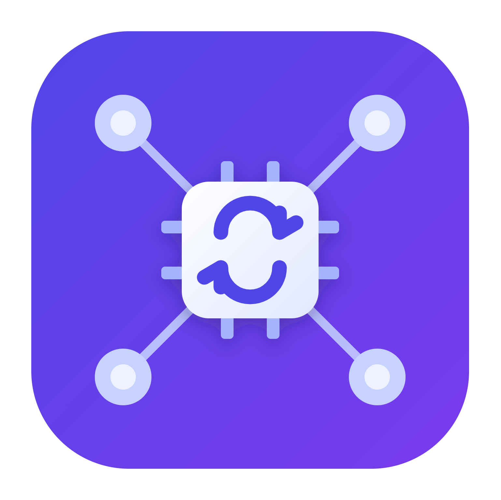
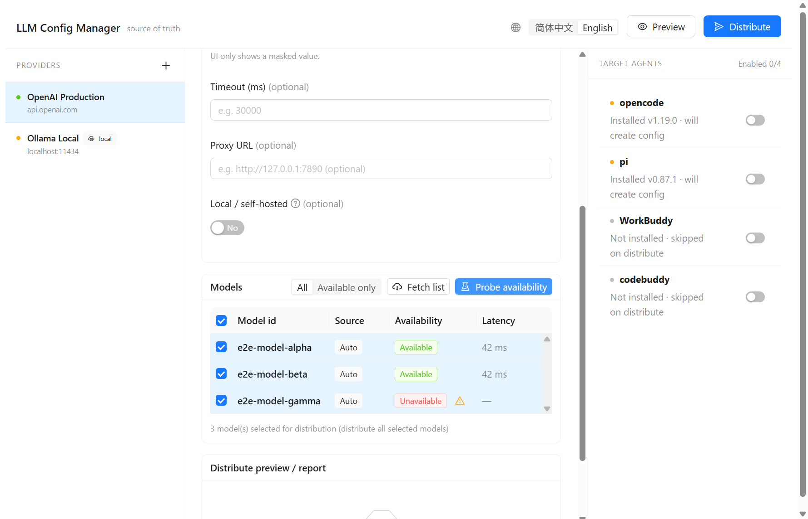
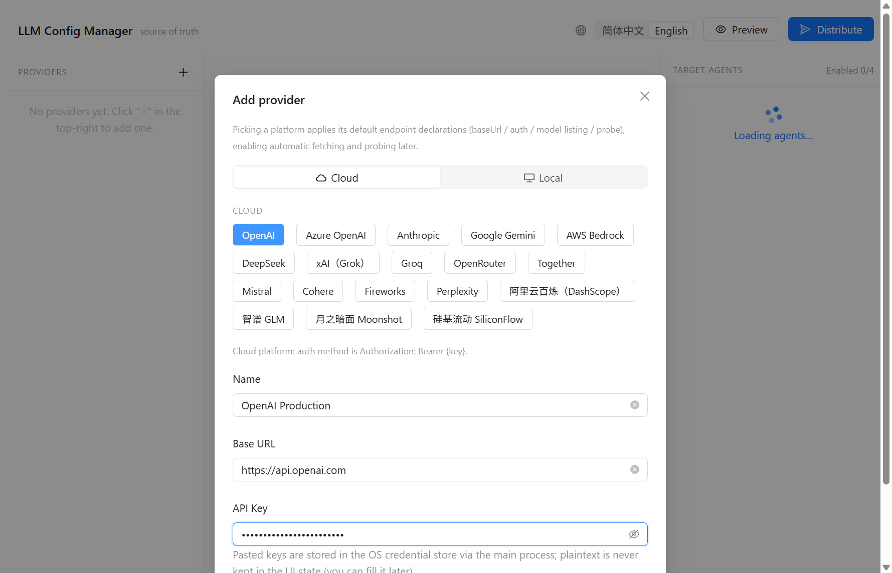
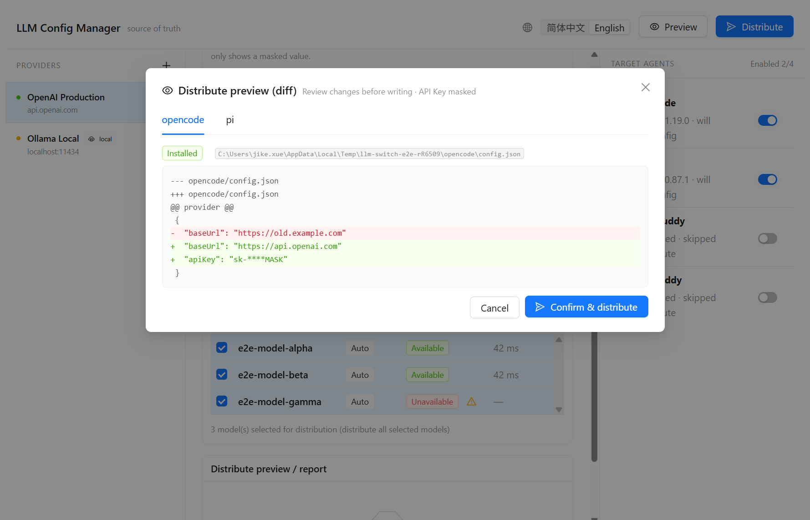
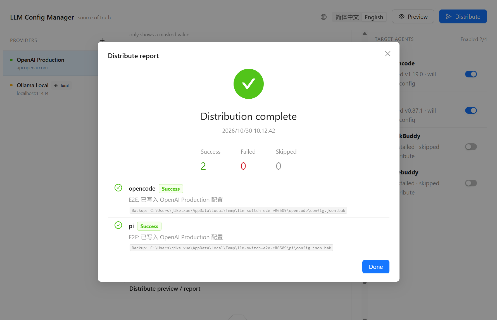

<div align="center">



# LLM Config Manager

**One source of truth for your LLM provider configs — maintain them once, distribute to multiple local AI agents with a click.**

English · [简体中文](./README.zh-CN.md)

[](../../actions)
[](../../releases)
[](#license)

</div>

---

## What is it

LLM Config Manager is a cross-platform desktop app (Electron + React) that keeps your LLM
**provider configuration** vendor-neutral and in one place, then **distributes** it into the
config files of multiple local AI agents (opencode / pi / workbuddy / codebuddy). API keys are
stored in the OS credential store and **never written to config files or the UI state in plaintext**.



## Features

- **Vendor-neutral provider config** — name, base URL, timeout, proxy, local/self-hosted flag. One config, many agents.
- **Secure API keys** — plaintext goes straight to the OS credential store; the UI only ever shows a masked value.
- **Built-in presets** — OpenAI, Anthropic, Azure OpenAI, Gemini, Bedrock, DeepSeek, Qwen/DashScope, Ollama, LM Studio, vLLM and more. Picking a preset pre-fills endpoints for listing and probing.
- **Model discovery & probing** — fetch the live model list from the provider, probe each model for availability (with latency), and filter to *available only*.
- **Preview before you write** — a masked diff per target agent shows exactly what will change; nothing touches disk until you confirm.
- **One-click distribute** — field-level merge into each agent's config with automatic backup and per-agent success/failure/skip report.
- **Safe by design** — context isolation, sandboxed renderer, no Node in the renderer, atomic writes with rollback.

## Screenshots

| Add a provider | Model discovery & probing |
| --- | --- |
|  |  |

| Preview diff (masked) | Distribute report |
| --- | --- |
|  |  |

## Download

Grab the latest installer for your platform from the [**Releases**](../../releases) page:

| Platform | Installer |
| --- | --- |
| Windows | `LLMConfigManager-<version>-win-x64.exe` (NSIS installer) |
| macOS | `LLMConfigManager-<version>-mac-x64.dmg` / `...-arm64.dmg` |
| Linux | `LLMConfigManager-<version>-linux-x64.AppImage` / `.deb` |

> macOS builds are not notarized by default. On first launch you may need to allow the app in
> **System Settings → Privacy & Security**.

## Quick start

1. Click **+** in the left column to add a provider; pick a preset (cloud or local).
2. Paste your API Key and click **Save key** — it is stored in the OS keychain, masked in the UI.
3. Open the **Models** card → **Fetch list**, then **Probe availability** to see which models work.
4. In the right column, toggle the target agents you want to distribute to.
5. Click **Preview** to review the masked diff, then **Distribute** to write the configs.

## Development

Requirements: Node.js ≥ 18 and [pnpm](https://pnpm.io/).

```bash
pnpm install          # install deps (also fetches the Electron binary)
pnpm dev              # run the app in dev mode (electron-vite)
pnpm build            # build main/preload/renderer into dist/
pnpm test             # unit + property tests (vitest)
pnpm test:e2e         # end-to-end GUI tests (Playwright + Electron)
pnpm lint             # eslint
pnpm typecheck        # tsc --noEmit
```

Build installers locally (each OS builds its own target best):

```bash
pnpm dist:win         # Windows NSIS .exe   (run on Windows)
pnpm dist:mac         # macOS .dmg          (run on macOS)
pnpm dist:linux       # Linux AppImage/.deb (run on Linux)
```

See [`e2e/README.md`](e2e/README.md) for the automated GUI test suite, including the optional
**live API** integration tests.

## Continuous integration

`.github/workflows/build.yml` runs quality gates (lint / typecheck / unit tests) and then builds
**Windows, macOS and Linux** installers in parallel on GitHub-hosted runners. Pushing a `v*` tag
also publishes a **GitHub Release** with all installers attached.

```bash
git tag v0.1.0 && git push origin v0.1.0   # triggers a cross-platform release build
```

## Tech stack

Electron · React 18 · Ant Design 5 · TypeScript · electron-vite · Vitest + fast-check · Playwright · electron-builder.

## License

[MIT](#license) © 2025 LLM Config Manager
