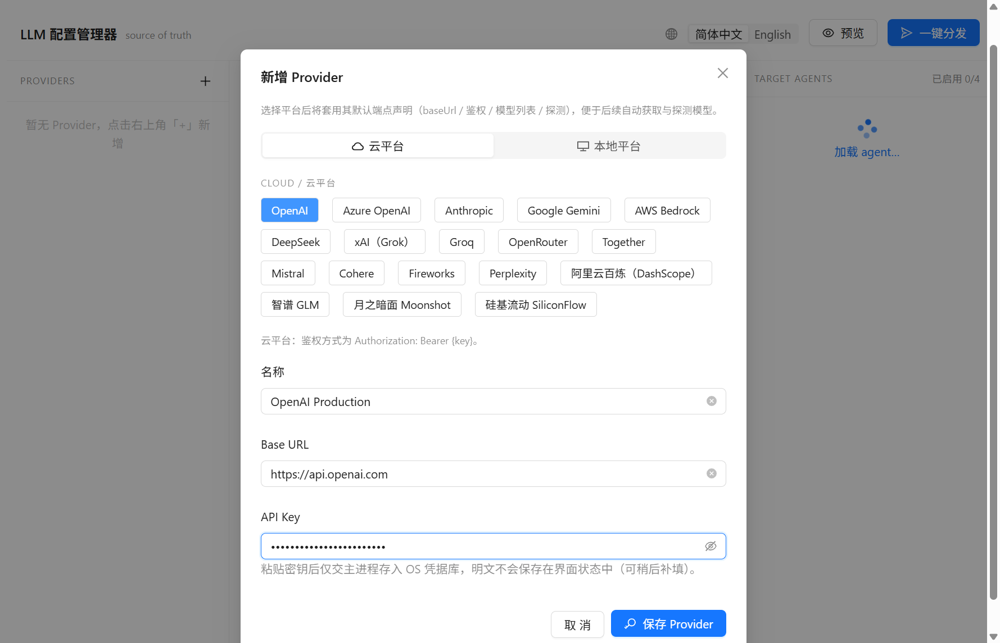
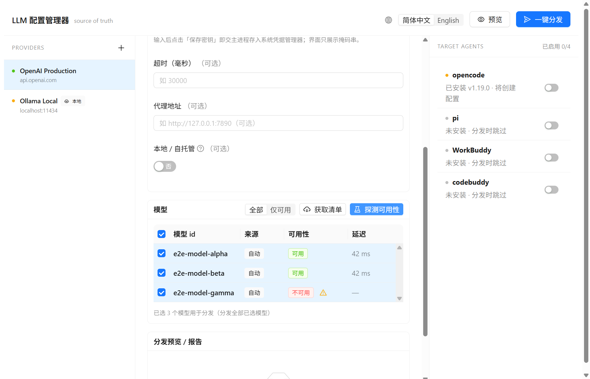
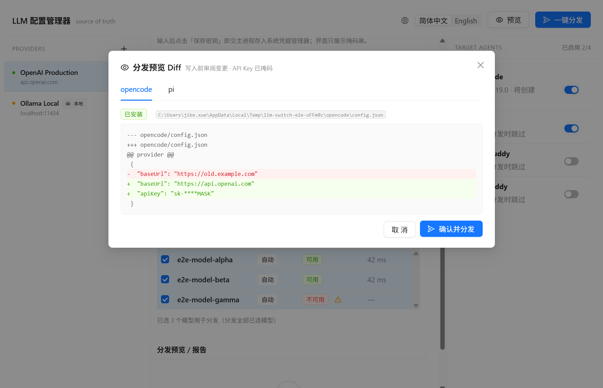
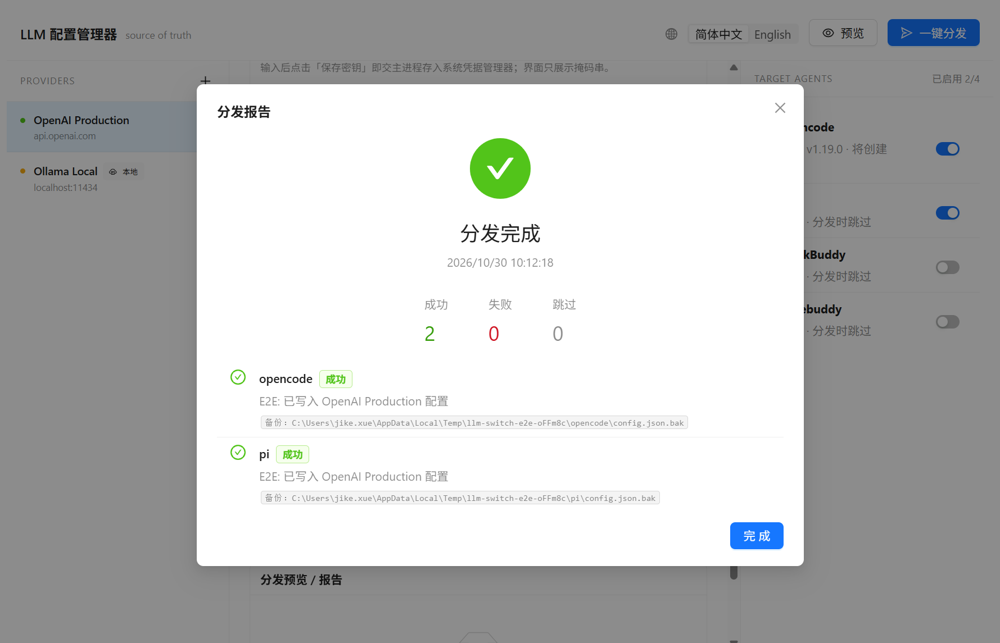

<div align="center">


# LLM 配置管理器

**LLM 配置的「唯一真相源」—— 一处维护，一键分发到多个本地 AI Agent。**

[English](./README.md) · 简体中文

[](../../actions)
[](../../releases)
[](#许可)

</div>

---

## 这是什么

LLM 配置管理器是一个跨平台桌面应用（Electron + React），把你的 LLM **Provider 配置**以
供应商中立的形式集中维护在一处，再**一键分发**到多个本地 AI Agent（opencode / pi / workbuddy /
codebuddy）的配置文件中。API Key 保存在操作系统凭据管理器里，**绝不以明文写入配置文件或界面状态**。


## 功能特性

- **供应商中立的 Provider 配置** —— 名称、Base URL、超时、代理、本地/自托管标记。一处配置，多处分发。
- **安全的 API Key** —— 明文直接交给系统凭据管理器保存；界面只展示掩码串。
- **内置平台预设** —— OpenAI、Anthropic、Azure OpenAI、Gemini、Bedrock、DeepSeek、通义千问 / 百炼、Ollama、LM Studio、vLLM 等。选中预设会自动套用「模型列表 / 探测」端点声明。
- **模型发现与探测** —— 自动拉取 Provider 的实时模型清单，逐个探测可用性（含延迟），并可筛选「仅可用」。
- **写入前预览** —— 为每个目标 Agent 生成掩码 Diff，清晰展示将要变更的内容；确认前绝不写盘。
- **一键分发** —— 对每个 Agent 做字段级合并、自动备份，并给出逐 Agent 的成功 / 失败 / 跳过报告。
- **安全设计** —— 上下文隔离、渲染进程沙箱、渲染进程无 Node 能力、原子写入并支持回滚。

## 功能截图

| 新增 Provider | 模型发现与探测 |
| --- | --- |
|  |  |

| 分发预览（掩码 Diff） | 分发报告 |
| --- | --- |
|  |  |

## 下载

在 [**Releases**](../../releases) 页面下载对应平台的安装包：

| 平台 | 安装包 |
| --- | --- |
| Windows | `LLMConfigManager-<版本>-win-x64.exe`（NSIS 安装器） |
| macOS | `LLMConfigManager-<版本>-mac-x64.dmg` / `...-arm64.dmg` |
| Linux | `LLMConfigManager-<版本>-linux-x64.AppImage` / `.deb` |

> macOS 安装包默认未做公证。首次启动如遇提示，请在 **系统设置 → 隐私与安全性** 中允许运行。

## 快速上手

1. 点击左栏的 **+** 新增 Provider，选择一个平台预设（云平台或本地平台）。
2. 粘贴 API Key 并点击 **保存密钥** —— 密钥存入系统凭据管理器，界面只显示掩码。
3. 打开 **模型** 卡片 → **获取清单**，再点 **探测可用性** 查看各模型是否可用。
4. 在右栏勾选要分发到的目标 Agent。
5. 点击 **预览** 审阅掩码 Diff，确认后点 **一键分发** 写入各 Agent 配置。

## 开发

环境要求：Node.js ≥ 18 与 [pnpm](https://pnpm.io/)。

```bash
pnpm install          # 安装依赖（同时补齐 Electron 二进制）
pnpm dev              # 开发模式运行（electron-vite）
pnpm build            # 构建 main/preload/renderer 到 dist/
pnpm test             # 单元测试 + 属性测试（vitest）
pnpm test:e2e         # 端到端 GUI 测试（Playwright + Electron）
pnpm lint             # eslint
pnpm typecheck        # tsc --noEmit
```

本地构建安装包（每个平台在各自系统上构建效果最佳）：

```bash
pnpm dist:win         # Windows NSIS .exe   （在 Windows 上运行）
pnpm dist:mac         # macOS .dmg          （在 macOS 上运行）
pnpm dist:linux       # Linux AppImage/.deb （在 Linux 上运行）
```

自动化 GUI 测试套件（含可选的 **真实 API** 集成测试）说明见 [`e2e/README.md`](e2e/README.md)。

## 持续集成

`.github/workflows/build.yml` 会先跑质量门禁（lint / typecheck / 单元测试），随后在 GitHub
托管 runner 上**并行构建 Windows、macOS、Linux 三平台安装包**。推送 `v*` 标签时还会自动创建
**GitHub Release** 并附上全部安装包。

```bash
git tag v0.1.0 && git push origin v0.1.0   # 触发跨平台发布构建
```

## 技术栈

Electron · React 18 · Ant Design 5 · TypeScript · electron-vite · Vitest + fast-check · Playwright · electron-builder。

## 许可

[MIT](#许可) © 2025 LLM 配置管理器
